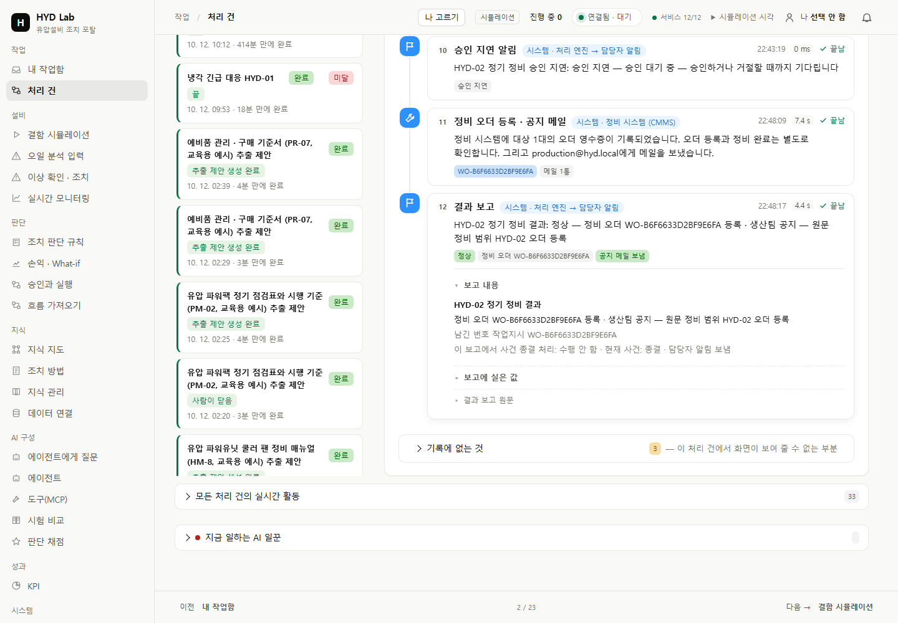

# 교육 ERP 초기화 결손 수정·실제 B 완주

리턴 필터 부재를 사용자 실재고 자료의 외부 차단으로 분류한 판단을 정정한다. 저장소는 ERP를 교육용 가상 데이터로 명시한다. 제공 초기 데이터에서 빠진 품목을 공식 명세·초기화·증분 migration으로 준비하는 것은 우리 작업이다. 사용자가 모르는 재고 자료나 MCP URI를 찾아와야 한다고 전제하지 않는다.

## 실제 결과

- B-ERP-20261012-v1/SQL057: 리턴 필터 품목과 보유2·예약0을 없는 행에만 추가했다. 가격12만원/재고는 교육 설계값이며 PM-02 원문의 요구량1개 또는 실창고 관측과 구분한다. 기존 ERP 행·예약·발주·B/C 원문, 반복 적용 결과가 불변이다.
- 같은 B 처리 건을 Sol6.1로 한 번 재평가하고 사용자 위임으로 승인했다. **작업지시 WO-B6F6633D2BF9E6FA 1건, 씰/필터 각1 예약, 생산팀 SMTP 공지, 결과 보고·COMPLETED**를 실제 API/DB 영수증으로 확인했다. 씰 가용6·필터 가용1이다.
- 기존58이벤트/보류 기록을 그대로 보존한다. 누적11950·정비 후1950시간·회차/물리 완료 값은 불변이며 작업지시 연결만 생겼다. 물리 정비·계수기 초기화를 수행했다고 표시하지 않는다.
- 결과 화면에서 영어 시스템 detail과 보고 종결 동작/현재 사건 혼동을 발견해 수정했다. typed 영수증의 한국어 표시와 저장 원문을 분리하고 미래 SQL058 영수증을 Memory 표현과 맞췄다. 기존 거래/SMTP/보고 원문 수정·재발송0이다.

## 실제 화면과 참고 비교

[완료1024](native-B-final/B-final-result-1024.png) · [보고상세1024](native-B-final/B-final-report-detail-1024.png) · [보존 원문](native-B-final/B-final-report-original-tail-1440.png) · [ProcessGPT/Dify와 나란한 비교](native-B-final/reference-B-final-comparison.png).

최종 GET은 두 폭의 결과·상세·원문6PNG와 원문 끝부분2PNG다. 정상 요약은 한국어이고 보고 자체의 종결 동작 없음/현재 사건 종결을 분리한다. 원문 JSON은 저장 보고와 정확히 같다. 실제 제품 DOM만 캡처했고 소스812/업무COMPLETED 불변·쓰기/console/pageerror0을 확인했다. 루트가 최종 상세와 참고 비교PNG를 직접 열어 확인했다. 참고는 보존된 ProcessGPT/Dify 이미지의 날짜·SHA를 유지하며 현재 참고 앱 가동이나 픽셀 동등·전체 UIUX 인수를 주장하지 않는다.

## 필요한 집중 검증

| 범위 | 결과 |
|---|---|
| 초기화/실행 계약 | 신규12통과0.89초, 기존PG1통과0.46초; Memory 기존 저장값·seed/증분·실제PG 소비/예약/중복 실행·반복 migration 보존 |
| 결손 역실험 | 필터 제거 시 예상1실패0.15초; 원문 정책 ScopeError를 성공으로 바꾸지 않음 |
| 완료 보고 표시 | 새 Node 계약·실제 완료 B 영수증2개, 기존caseRecord1통과0.86초; 자유문·미상 영수증·원문·조회 대기/실패 경계 |
| SQL058 실제PG | 기존행/영수증 재전달/반복 불변, 새 영수증은 Memory와 같은 한국어; 예약량 동일, 시험 효과 전부 rollback |
| 실제 스택 적용 | SQL057/058 적용, 기존 ERP/B/C 원문 보존; process시작시각/재시작0 유지, owned worker/임시PG 종료 |

원래2673 전체 결과는 당시 판본이다. 이번에 전체 회귀·A/C 재완주·문서 재적재·F27 반복0이며 B의 필요한 재평가1회만 수행했다. [초기 명세](b-spec.md) · [표시 명세](ui-positive-spec.md) · [초기 증거](evidence-index.md) · [실제 완주·후속 증거](index-phase2.md) · [최종 exact-copy 목록](final-copy-manifest.json).

## 보존한 실패와 한계

첫 enterprise-sim 배포에서 ENTERPRISE_BACKEND가 생략돼 memory가 선택됐다. 승인 전에 supabase로 복원하고 현재 씰7/필터2·현재 정비 창을 공식 새 검토본으로 검사해 승인했다. 이후 배포에는 ENTERPRISE_BACKEND=supabase를 명시한다. 기존 추천은 별도 원문으로 보존한다.

첫 live watcher는 공개PNG1/SSE 일부 수신 뒤 갱신 중 DOM 분리로 중단했다. 같은 새 run의 공개/도구 전 구간 livePNG가 모두 성공했다고 주장하지 않는다. 저장된 최신 도구/최종 화면을 live 성공으로 바꾸지 않는다. 숨은 추론을 표시·보관하지 않는다. 저장 화면의 첫 hidden-record timeout, history 수집기의 옛 generation 선택 오류, 첫 PG 수집기의 Memory정비창/PG원천 불일치 거절도 보존한다. 검사 대상·원천을 바로잡았고 제품 정책이나 성공 기대값은 고치지 않았다.

K3 실제 Google 인증/회의는 미완료다. [우리가 준비한 연결 경로](google-connection.md)는 서버 이름·주소·등록 계획과 계정 소유자가 해야 하는 OAuth 앱 등록/본인 동의를 구분한다. 학생 포털 로그인은 요구하지 않는다. ChatGPT 앱 인증을 HYD 워커에 넘겼다고 표시하지 않는다. 전체 수업 운영/사용자 최종 시각 인수도 이 집중 완료 결과와 구분한다.
