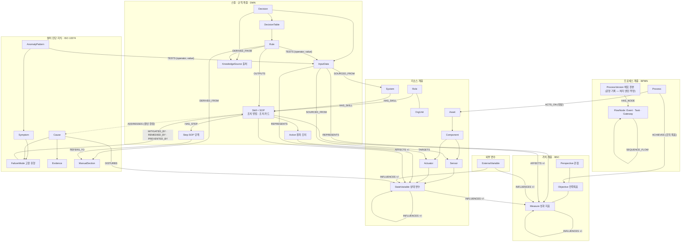
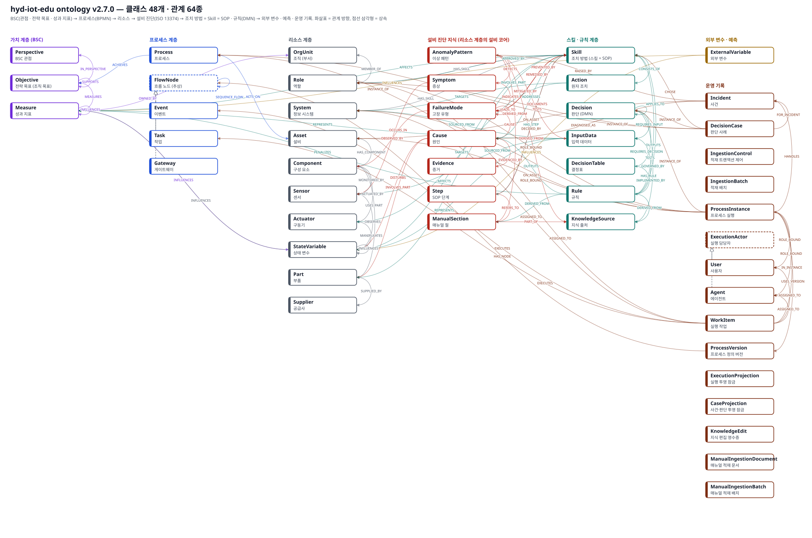
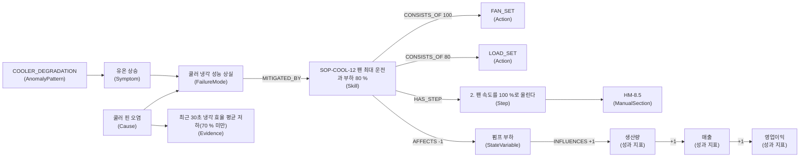

# 온톨로지 스키마 v2 — BSC · 프로세스 · 리소스 · 스킬

L7 온톨로지의 설계 문서다. 이 문서는 스키마(클래스와 관계의 틀)를 설명한다. 인스턴스는 스키마에 맞춰 따로 만든다.

지금 판은 `schema.json`의 `version` 2.7.0이다(클래스 · 관계 수는 [class-table.md](class-table.md)). 쓰는 곳이 없어 지운 요소(판 번호는 그대로): 조치별 예측 클래스 Forecast(FORECASTS · ASSUMES · GIVEN), 손으로 옮겨 적은 업무 흐름이 쓰던 관계(READS · PRODUCES · INVOKES · PERFORMED_BY · CORRELATES · ATTACHED_TO), 실행 투영의 MAPS_TO. 시드도 한 벌이다(구조판 · 전체판 두 판을 없앴다).

v2.6은 관계 하나만 더했다: `(:FailureMode)-[:PREVENTED_BY]->(:Skill)` 예방 조치(정기 정비). 기존 클래스 · 관계는 이름도 뜻도 그대로다(아래 "조치 방법" 절).

v2.7은 기존 Skill에 명시 업무 범위 `scope=purchase`와 실행 후보 여부 `executable`을 더했다. 클래스는 그대로이며 INVOLVES_PART의 기존 Cause→Part에 Skill→Part 끝점을 가산했다. 구매 SOP는 검증된 보관 원문·단계·Part 범위와 ERP 수행 관계가 필요하다. 참고 보관(false)과 PR_CREATE 실행 후보(true)를 구분하며 실행 후보는 구매 승인 역할·공급사/부품 공급 관계를 추가 검사한다. 고장 유형을 지어내지 않고, 기존 scope 없는 고장 조치의 FM 필수 조건은 유지한다. 검사는 `validate`(구매 범위 — `hydcommon.skill_scope.purchase_graph_issues`)가 한다.

v2.1은 세 표준(BPMN · DMN · BSC)을 시나리오가 쓰는 만큼의 미니멀 셋으로 다듬었다(3절의 미니멀 셋 표).

## 1. 왜 다시 만들었나

v1은 "시작 대상 → 조회 정보 → 규정 판단 → 실행"이라는 일의 순서를 노드로 그렸다. 그것은 프로세스이고 BPM이 이미 다루는 영역이다. "판단 시나리오", "정보 유형" 같은 노드는 클래스가 아니었고, 스키마 그림과 인스턴스 그림이 섞여 사람도 기계도 해석하기 어려웠다.

v2의 설계 원칙은 여섯 가지다.

1. **계층:** 맨 위에 BSC(관점 · 전략 목표 · 성과 지표), 그 아래 전략 목표(조직 목표)를 달성하는 프로세스, 일을 하는 리소스, 조치 방법인 스킬과 규칙이 있다. 옆에 외부 변수가 붙는다. 조치 후 예측값은 그래프에 두지 않는다 — 카드를 만들 때 설비 모델(`common/hydcommon/forecast.py`)이 그때 설비 상태로 계산하고, 그래프는 설비가 쓰는 모델 · 판만 가진다(`Asset.forecastModel` · `forecastRevision`, 템플릿 `t3_forecast_model`).
1. **조치 방법은 Skill이다:** 스킬 하나가 SOP 하나다. 기존 고장 조치는 고장 유형(FailureMode)에 즉시 완화 · 근본 조치 · 예방 조치 중 하나로 매칭된다. 명시한 원문 구매 SOP는 Part 업무 범위에 연결하며 고장 유형을 추정하지 않는다. Part 범위는 이 SOP를 사용할 수 있는 부품 목록이다.
2. **상충 관계가 핵심이다:** BSC 성과 지표끼리, 그리고 설비 상태와 성과 지표 사이에 `+`/`-` 영향 관계를 둔다. 에이전트는 이 관계를 따라 거시적으로 판단한다. 관계가 없으면 선을 긋지 않는다.
3. **표준에서 준용한다:** 가치는 BSC, 프로세스는 BPMN, 규정과 판단은 DMN, 설비 진단은 ISO 13374 / MIMOSA(아키텍처 v4)를 따른다. 시나리오에 필요한 만큼만 가져왔다.
4. **스키마가 먼저다:** 클래스와 관계, 속성 정의(`schema.json`)가 단일 원본이다. 인스턴스 스크립트, Neo4j 제약, OWL 파일, 에이전트용 스키마 설명은 모두 이 원본을 따른다.
5. **평가할 수 있어야 한다:** 그래프가 스키마를 지키는지 기계로 검사한다. 질의 예시마다 기대 결과가 있다.

## 2. 계층 구조



그림에 없는 것: 흐름 노드의 수행자 · 데이터 입출력 · 부르는 판단 · 시작 경보는 그래프 관계가 아니다 — 실행 정의(`it/process/definitions/` · 수업 흐름 `it/process/procsvc/course_flows.json`)가 정본이고, 그래프의 흐름 노드는 배포된 정의 판본을 처리 엔진이 투영한 것이다. 운영 기록 계층(사건 · 판단 사례 · 처리 건 · 작업)도 그림에서 뺐다(전체는 [ontology-classes.svg](ontology-classes.svg)).

## 3. 표준 준용

| 표준 | 가져온 요소 | v2 클래스 · 관계 |
|---|---|---|
| BSC | 관점, 전략 목표(조직 목표), 성과 지표, 전략맵 인과 | Perspective, Objective, Measure, `SUPPORTS`, `MEASURES`, `INFLUENCES`, `ACHIEVES`(프로세스 → 전략 목표) |
| BPMN 2.0 | Process(객체: 달성 목표 · 대상 설비), 배포된 정의 판본의 흐름 노드 — Event(트리거는 eventDefinition · messageRef · correlationKey 속성), Task(taskType · 에이전트 작업이면 agentMode), Gateway, SequenceFlow | Process, ProcessVersion, FlowNode, Event, Task, Gateway, `ACHIEVES`, `ACTS_ON`, `HAS_NODE`, `SEQUENCE_FLOW`. 수행자 · 데이터 입출력 · 경계 부착 · 부르는 판단은 실행 정의에 있고 그래프에 두지 않는다 |
| DMN 1.x | Decision, InputData, Decision Table(hit policy, Rule = 입력 항목의 임계값 검사), Knowledge Source, 정보 · 권한 요구 | Decision, InputData, DecisionTable, Rule, KnowledgeSource, `TESTS {operator, value}`, `REQUIRES_INPUT`, `REQUIRES_DECISION`, `GOVERNED_BY`, `DERIVED_FROM` |
| ISO 13374 / MIMOSA | SD 상태 감지, HA 건강 평가, AG 권고 | AnomalyPattern, Symptom, FailureMode, Cause, Evidence, ManualSection. AG 권고는 고장 유형에 매칭된 Skill(= SOP)과 Step |
| ISO 14224 취지 | 설비 단위, 정비 가능 품목, 고장 모드 · 원인 | Asset, Component, FailureMode, Cause |

### 미니멀 셋 — 시나리오가 쓰는 것만

표준의 모든 요소를 담지 않았다. 수업 시나리오(A 냉각 긴급 대응 · B 정기 정비 · C 예비품 구매)와 그 실행 기록이 실제로 쓰는 요소만 둔다(`schema.json` conventions `minimalSet`). `validate`는 인스턴스가 쓰지 않는 스키마 요소를 그때 그래프로 센다(이 문서에 수를 적지 않는다 — 수업 그래프는 시드 + 수업 문서 적재분이고, 실행 기록 요소는 처리 건이 돌아야 생긴다).

| 표준 | 시나리오에 꼭 필요해서 담은 것 | 쓰지 않아 뺀 것 |
|---|---|---|
| BPMN | 프로세스의 달성 목표 · 대상 설비, 배포 판본의 흐름 노드 — 시작 이벤트(메시지 = 경보, 상관 키 = 설비), 경계 타이머, 종료, 작업 종류 · 게이트웨이 종류(허용값은 schema.json), 순서 흐름 | 중간 이벤트, 조건 · 신호 · 오류 이벤트, 풀 · 레인 · 메시지 흐름, 그래프 안의 수행자 · 데이터 입출력(실행 정의가 정본) |
| DMN | 판단, 입력 데이터, 결정표, 임계값 검사(연산자 6종), hit policy 3종(PRIORITY · COLLECT · UNIQUE), 지식 출처, 정보 · 권한 요구 | hit policy FIRST · RULE ORDER, 업무 지식 모델(BKM), FEEL 함수, 출력 열 정의, 결정 서비스 |
| BSC | 관점 4개, 전략목표, 성과 지표(방향 · 목표 · 경고 · 위험 임계값 · 계산식), 성과 지표 간 `+`/`-` 영향, 성과 지표 소유 부서 | 실행 과제(Initiative) 별도 클래스, 가중치 스코어카드, 목표 대비 실적 시계열 |

## 4. 클래스

### 클래스 이름 (영문 · 한글)

스키마 원본의 label_ko에서 생성한 표다 ([class-table.md](class-table.md)). 모든 클래스와 관계를 한 장에 그린 그림은 [ontology-classes.svg](ontology-classes.svg)다.



클래스 목록(영문 · 한글 · 계층 · 준용 표준)은 위 표 파일 하나가 정본이다 — 이 문서에 사본을 두지 않는다.

### 클래스 속성

전체 속성은 [schema_prompt.md](../../../../it/neo4j/v2/schema_prompt.md)에 있다. `!`는 필수 속성이다.

속성의 허용값 · 필수 여부는 `it/neo4j/v2/schema.json`이 정본이다 — 생성물 `schema_prompt.md` · `ontology-schema.ttl`과 표 [class-table.md](class-table.md)에 그대로 나온다(이 표에는 사본을 두지 않는다).

| 계층 | 클래스 | 핵심 속성 | 뜻 |
|---|---|---|---|
| BSC | Perspective | order! | BSC 관점. 학습=1 … 재무=4 |
| | Objective | name! | 전략 목표 (조직 목표). 프로세스가 달성하려는 대상 |
| | Measure | unit!, direction! (UP · DOWN), kpiRole! (leading 선행 동인 · lagging 후행 결과), formula, target, thresholdWarn · thresholdCrit | BSC 성과 지표. 상충 관계의 노드. 후행 지표는 선행 지표를 움직이지 않고, 선행 지표는 INFLUENCES 경로로 후행 지표에 닿는다 |
| 프로세스 | Process | isExecutable | 업무 프로세스(객체 — 이름 · 달성 목표 · 대상 설비). 처리 순서 · 담당 · 분기 조건은 실행 정의가 정본 |
| | Event : FlowNode | position!, eventDefinition!, messageRef, correlationKey, timer | 시작 · 경계 · 종료 이벤트. 트리거는 이 속성들이다. 흐름 노드(FlowNode 공통: definition_id · version · element_id)는 처리 엔진이 배포 판본에서 투영한다 |
| | Task : FlowNode | taskType!, tool, agentMode, orchestration | 작업. 에이전트 작업이면 agentMode(DRAFT · COMPLETE) |
| | Gateway : FlowNode | gatewayType! | 분기(exclusive · parallel) |
| 리소스 | OrgUnit · Role · System | level!(Role), zone!(System) | 조직, 역할, 정보 시스템(에이전트 포함) |
| | Asset · Component · Sensor · Actuator | code!(Asset), tag!(Sensor), resource!(Actuator) | 설비와 계측 · 구동. Asset의 forecastModel · forecastRevision은 조치 후 예측에 쓰는 설비 모델 |
| | StateVariable | unit!, kind! | 물리량. 물리 영향을 성과 지표로 잇는 다리 |
| | Part · Supplier | partNo(Part), avl! · oem!(Supplier) | 교체 부품과 공급사. oem은 「순정 우선」 구매 절차가 고르는 값 |
| 설비 진단 | AnomalyPattern | code!, rule!, holdSeconds, detectionMode, clearRule, severity | 감지기 탐지 패턴. 탐지 임계값은 TESTS로 입력 데이터에 걸고, 사람이 읽는 rule은 시드가 TESTS에서 만든다 |
| | Symptom · FailureMode · Cause | prior!(Cause) | 증상, 고장 모드, 원인 |
| | Evidence | rule!, sql!, expect!, threshold!, weight! | 원인 확증 근거 |
| | ManualSection | ref!, title! | 매뉴얼 절 |
| 스킬 · 규칙 | Skill | sopId!, kind!, description!, scope, executable | 조치 방법 = SOP = 조치 가이드 카드 한 장. 단계가 1개 이상, 고장 유형 매칭이 1개 이상 있어야 한다(구매 SOP `scope=purchase`는 고장 유형 대신 Part 범위 · ERP, 참고 보관 `kind=reference`는 매칭 없음) |
| | Step | order!, text! | SOP 단계. 근거 매뉴얼 절을 가리킨다 |
| | Action | code!, kind!, param, min, max | 원자 조치 (PLC 쓰기 · 시스템 트랜잭션) |
| | Decision | question! | 판단 정의 |
| | InputData | variable!, typeRef! | 판단 · 이상 패턴이 검사하는 데이터. 출처(SOURCED_FROM — 시스템 · 센서)가 있고, 상태 변수 · 성과 지표를 가리킨다(REPRESENTS) |
| | DecisionTable · Rule | hitPolicy! (엔진이 평가하는 표는 cards.EXECUTED_HIT_POLICIES와 같아야 한다), when!, effect! | 결정표와 규칙. 규칙은 임계값 검사(TESTS)를 하나 이상 가진다 (RANK 제외) |
| | KnowledgeSource | kind! | 매뉴얼, 사내 규정, 정책, 전략맵 |
| 외부 | ExternalVariable | unit! | 외생 변수(환율 · 외기 온도 · 전력 단가 · 고객 수요) |
| 운영 기록 | Incident · DecisionCase | alertId!, followedRecommendation! | 사건과 사람의 판단 사례(선례) |
| | ProcessInstance · WorkItem · ProcessVersion · ExecutionActor(User · Agent) | status!(처리 건 · 작업), definition_id! · version!(판본) | 처리 건 · 작업 · 배포 판본 · 실제 담당자 — 처리 엔진이 실행을 투영한다 |
| | IngestionControl · IngestionBatch · ExecutionProjection · CaseProjection · KnowledgeEdit · ManualIngestionDocument · ManualIngestionBatch | — | 적재 · 투영 · 편집의 영수증(내부 기록 — 지식 지도에 보이지 않는다) |

## 5. 상충 관계 규칙

- `INFLUENCES {sign}`: 성과 지표 · 상태 변수 · 외부 변수가 다른 성과 지표나 상태 변수를 움직인다. 원천이 오르면 대상이 `sign` 방향(+1 · -1)으로 움직인다.
- `AFFECTS {sign, delta}`: 스킬이 상태 변수나 성과 지표를 움직인다. 스킬의 효과는 `AFFECTS` 한 번 뒤 `INFLUENCES*`를 따라 영업이익까지 이어진다. 경로의 sign을 곱하면 이익에 대한 방향이 나온다.
- 관계가 없으면 만들지 않는다. sign 0은 허용하지 않는다. 예: 재고량과 매출 사이에는 선이 없다.
- 조건부 영향은 `condition`에 조건을 적는다. 예: 부품 단가와 품질의 관계는 "공급사를 바꿔 단가를 낮출 때"만 성립한다. 환율로 같은 부품 값이 오를 때는 성립하지 않는다.

회의에서 든 예시가 인스턴스에 그대로 들어 있다.

```
매출 +→ 영업이익,  총비용 -→ 영업이익
재고량 +→ 재고 보관비 +→ 총비용           (재고량과 매출: 선 없음)
부품 단가 +→ 부품 구매비 +→ 총비용         → 단가를 낮추면 이익 +
부품 단가 +→ 부품 품질 -→ 품질 클레임 -→ 브랜드 신뢰 +→ 매출   → 공급사를 바꿔 낮추면 이익 -
환율 +→ 부품 단가,  환율 -→ 매출 (가격 정책 조건부),  환율 +→ 재고량 (가격 정책 조건부)
```

### 조치 방법 = Skill = SOP, 고장 유형에 매칭

조치 방법은 Skill 하나로 표현한다. 스킬 하나가 SOP 하나다.

- **SOP를 직접 갖는다:** 스킬은 `sopId`와 단계(`HAS_STEP → Step → REFERS_TO → ManualSection`)를 직접 갖는다. 별도 절차 클래스는 없다.
- **고장 유형에 매칭된다:** `(:FailureMode)-[:MITIGATED_BY]->(:Skill)`은 즉시 완화, `(:FailureMode)-[:REMEDIED_BY]->(:Skill)`은 근본 조치, `(:FailureMode)-[:PREVENTED_BY]->(:Skill)`은 예방 조치다.
- **예방 조치(v2.6 추가):** 정기 정비는 생긴 고장을 없애는 일이 아니라 고장을 미리 막는 일이다(준용 EN 13306 preventive maintenance · ISO 14224 PM). 그래서 근본 조치(REMEDIED_BY)와 따로 둔다. 같은 양식(N:M, `_manual_document`)이고 필수 조건 "스킬은 고장 유형에 매칭"을 `MITIGATED_BY|REMEDIED_BY|PREVENTED_BY`로 넓혔을 뿐 기존 것은 바꾸지 않았다. 경보(고장) 대응 후보(t2 템플릿 · 자동 후보 연결)는 즉시 완화 · 근본 조치만 따라가고, 정기 정비 도래(PM_DUE) 후보는 문서가 낸 후보 규칙이 예방 조치 스킬을 고른다. 예: 주 펌프 체적 효율 저하 -PREVENTED_BY-> SOP-PM-21(2,000 h 정기 점검).
- **원인 한정:** 근본 조치가 고장 유형의 특정 원인에만 맞으면 `(:Skill)-[:ADDRESSES]->(:Cause)`를 단다. 같은 "쿨러 냉각 성능 상실"이라도 핀 오염이면 핀 세척(SOP-COOL-14), 주변 온도 상승이면 캐비닛 환기 보강(SOP-COOL-15)이다.
- **스키마가 강제한다:** 단계가 없거나 고장 유형에 매칭되지 않은 스킬은 `validate`에서 위반으로 잡힌다(구매 SOP는 Part 범위 · ERP 수행, 참고 보관은 실행 · 후보 관계 없음으로 따로 잰다).
- **어느 SOP가 어느 고장 유형에 붙는가:** 시드에 없다 — 수업 문서(HM-8 · PM-02 · PR-07)의 강사 서명 추출 묶음 `it/process/procsvc/course_extractions.json`을 시작이 적재해 만든다(`scripts/class_knowledge.py`). 지금 그래프의 목록은 질의 `q2b-failure-mode-skills`(고장 유형 · 종류 · SOP · 단계 수 · 원인 한정)로 본다 — 이 문서에 사본을 두지 않는다.

### 원문 참고와 정확한 기존 SOP 재참조

`kind=reference`와 `executable=false`를 명시한 매뉴얼 절차는 원문 보관만 한다. FM·승인 역할이 미상이어도 Section·Step·실제 인용을 보존하지만 실행 시스템·Action·후보 Rule 연결은 만들지 않는다. 기존 fault 실행의 FM 요구와 purchase의 Part/ERP/승인/공급 계약은 유지한다.

`Step-[:DOCUMENTS]->Skill`은 새 문서의 원문 단계가 기존 Skill을 정확히 재참조하는 출처 관계다. SOP 번호와 전체 단계가 같아야 하며 검토한 기존 승인·Action·시스템·현재 Step/Section 계약의 지문(hash)을 고정해 둔다. 기존 `HAS_STEP`에는 새 원문을 섞지 않고 기존 소유권·실행 내용도 바꾸지 않는다. 개정 · 되돌리기는 적재 기록 · 인용 · 지금 그래프 · 고정한 지문이 맞는 출처만 따로 보존하고, 바깥에서 바뀐 관계는 「달라짐」으로 거절한다. 실행 이력과 원문 출처는 같은 뜻으로 다루지 않는다.

### 임계값 규칙 (DMN)

- 임계값은 문장이 아니라 관계다: `(:Rule|AnomalyPattern)-[:TESTS {operator, value, unit}]->(:InputData)`. 연산자는 `<`, `<=`, `>`, `>=`, `==`, `!=`다.
- 한 규칙의 검사는 모두 AND다 (결정표의 한 행). OR는 행을 나눈다 — 두 조건 중 하나면 같은 스킬을 낼 때는 같은 스킬을 OUTPUTS로 가진 행 두 개를 둔다.
- `when`은 같은 조건을 사람이 읽게 쓴 문장이다. 검사기가 `when`과 TESTS가 같은 변수 · 연산자 · 값인지 확인한다.
- 입력 데이터는 `REPRESENTS`로 상태 변수나 성과 지표를 가리킨다. 그래서 "예측 유온 ≥ 65 ℃" 규칙이 유온의 인터록 한계 65 ℃와 같은 값임을 질의로 확인할 수 있다.
- 근거 문서(`DERIVED_FROM`): 규칙(시드 `rule:ts1-hard` → 규정 `ks:sr-04`, 문서 적재 규칙 → 그 매뉴얼 절)과 B · C의 업무 표 감시 패턴(`scenario_structure.cypher`)이 가진다. 설비 센서 패턴(`instances.cypher` 4절)은 그래프 근거 연결이 없다 — 기준의 원문(HM-8.3 정상 52 ℃ 미만 · 경보 55 ℃ 초과)은 시드 주석에만 있다.
- 임계값이 어디서 오는가: 탐지 임계값은 시드의 이상 패턴(`it/neo4j/v2/instances.cypher` 4절 — 예: 쿨러 성능 저하 TS1 > 55 ℃ · CE < 70 % · 유온 상승률 > 0, 해제 TS1 < 52), 시드 규칙은 예측 유온 인터록 제외 하나(`rule:ts1-hard`, 예측 유온 ≥ 65 ℃), 나머지 진단 · 후보 · 규정 규칙(예: 예측 유온 55 ℃ 이상 경고)은 수업 문서 적재가 만든다. 지금 그래프의 수치 임계값 전부와 이어진 상태 변수 한계 · 근거는 질의 `q14-thresholds`로 본다.

### 수업 시나리오 — 시작 · 대상 · 데이터 · 임계값 · 상충

시나리오는 셋이다: A 냉각 긴급 대응(쿨러 성능 저하 경보), B 정기 정비(정기 점검 도래 `PM_DUE`), C 예비품 구매(재고 보충 필요 `SPARE_BELOW_MIN`). 사실의 정본은 한 곳씩이다 — 사본 표를 두지 않는다.

| 무엇 | 정본 | 그래프에서 보는 질의 |
|---|---|---|
| 처리 순서 · 승인 · 기한 · 시작 경보 | 수업 흐름 `it/process/procsvc/course_flows.json`(`c3_cooling` · `c3_pm` · `c3_spare`) | — |
| 프로세스 객체(달성 목표 · 대상 설비) | `instances.cypher` 6절 | `q11-processes` |
| 탐지 패턴 · 판단 입력 | `instances.cypher` 3 · 4절, B · C의 업무 표 감시 패턴 · 입력은 `scenario_structure.cypher`, B의 일정 옮기기 조치는 `pm_capabilities.cypher` | `q12-scenario-profile`(A), `q13-decision-inputs` |
| 고장 유형 · 원인 · SOP · 규칙 | 강사 서명 추출 묶음 `course_extractions.json`(HM-8 · PM-02 · PR-07) | `q2b-failure-mode-skills`, `q3-candidate-cards` |
| 상충(BSC) | `instances.cypher` 1절 | `q4-tradeoff-paths`, `q5-card-balance` |

판단마다 검사하는 데이터와 그 출처(시스템 · 센서)는 `q13-decision-inputs`로 본다. 그래프에는 작업 사이 데이터 흐름(옛 READS · PRODUCES)을 두지 않는다 — 단계의 입력 · 출력은 실행 정의가 정한다.

## 6. 스키마 그림과 인스턴스 그림

위 2절의 그림은 스키마 그림이다. 상자는 클래스, 화살표는 관계 종류다. 아래는 같은 스키마에 맞춘 인스턴스 경로 하나다. 쿨러 핀 오염 사건에서 에이전트가 찾는 경로이며, 상자는 실제 노드다.



카드의 조치 후 예측 유온은 이 경로에 노드로 없다 — 카드를 만들 때 설비 모델이 그때 설비 상태로 계산한다(1절).

Neo4j Browser에서 스키마 그림은 `CALL db.schema.visualization()`으로, 인스턴스 그림은 질의 결과로 따로 본다.

## 7. 에이전트가 쓰는 방법

GraphRAG는 Text2SQL과 같은 구조다. Text2SQL이 DDL과 질문을 함께 LLM에 주고 SQL을 받듯이, 에이전트는 온톨로지 스키마와 질문을 함께 주고 Cypher를 받는다.

```
사용자 질문 ─┐
             ├─▶ LLM ─▶ Cypher ─▶ Neo4j ─▶ 연결된 경로(그래프) ─▶ 조치 카드
schema_prompt.md (스키마) ─┘
```

1. **엔티티 인식:** 질문의 말을 전문 검색 색인 `ont_names`로 노드에 붙인다. "유온 냉각"이라는 말은 증상 "냉각 효율 저하", 상태 변수 "유온", 증상 "유온 상승"으로 이어진다.
2. **경로 질의:** 증상에서 고장 유형과 원인, 증거를 찾고, 그 고장 유형에 매칭된 조치 방법(스킬 = SOP)과 원자 조치, 단계, 매뉴얼까지 한 번에 가져온다.
3. **카드 작성:** 고장 유형에 맞는 후보 스킬을 결정표 규칙으로 고르고, 규정 규칙으로 거르고, 예측값과 득실 성과 지표를 붙인다.
4. **사람 확인:** 카드마다 출처(규칙의 근거 문서, SOP 단계의 매뉴얼 절, 원인의 증거)를 보여 준다.
5. **선례:** 사람의 선택은 DecisionCase로 남고, 다음 판단에서 같은 원인의 선택 이력으로 읽힌다. 단, 교육용 고정: 선례 몫은 미리 넣은 예시(`seeded = true`)만 센다 — 수업 그래프에는 그런 예시가 없어 선례 몫은 늘 0이고, 승인으로 투영된 사례는 그래프에 남지만 순위에 들어가지 않는다(`templates/t3_precedents.cypher`의 `WHERE dc.seeded = true` 한 줄을 빼면 제품처럼 쌓이는 학습이 켜진다).

질의 예시는 [queries.cypher](../../../../it/neo4j/v2/queries.cypher)에 있다. 블록마다 자연어 질문과 정답 Cypher가 있다.

질문 목록과 정답 Cypher는 `queries.cypher`의 블록마다 `@ask` 줄이 정본이다(이 문서에 사본을 두지 않는다). 예시 id는 수업 그래프(시드 + 수업 문서 적재분)의 것이다.

**온톨로지의 몫과 판단 엔진의 몫:** 온톨로지는 방향과 경로, 출처를 준다. q5처럼 한 카드에 득과 실이 함께 나오면, 어느 쪽이 더 큰지는 설비 모델이 계산한 조치 후 예측값(`hydcommon.forecast`, 에이전트 `agentsvc/forecasting.py`)과 기업 시스템의 금액 사실로 판단 엔진이 계산한다. DMN 결정표 `dt:rank-actions`가 그 자리다.

## 8. v1에서 v2로

| v1 | v2 | 이유 |
|---|---|---|
| Scenario (판단 시나리오) | 없음. 질문은 Decision.question, 흐름은 Process | 시나리오는 클래스가 아니라 인스턴스 경로다 |
| InfoType (무슨 정보) | InputData (DMN) + `SOURCED_FROM` System | 표준의 입력 데이터 개념으로 바꿈 |
| Option (대안) | Skill (= SOP. 원자 조치를 값과 함께 묶은 조치 카드) | 조치 방법이 스킬 계층의 단위 |
| Cause -MITIGATED_BY · REMEDIED_BY-> Action, Action -FOLLOWS-> Procedure | FailureMode -MITIGATED_BY · REMEDIED_BY-> Skill, Skill -HAS_STEP-> Step, 필요하면 Skill -ADDRESSES-> Cause | 조치 방법은 SOP인 스킬이고 고장 유형에 매칭된다 |
| Option -IMPACTS{expr}-> 성과 지표 | Skill -AFFECTS{sign}-> StateVariable · 성과 지표, 그 뒤 INFLUENCES* | 영향을 식 하나에 숨기지 않고 관계로 드러냄 |
| Policy (HARD · SOFT) | Rule (EXCLUDE · PENALTY · WARN) in DecisionTable, `DERIVED_FROM` KnowledgeSource | 규정은 DMN 규칙과 출처로 |
| Goal | Objective (BSC) + Perspective | 전략맵 구조 |
| BusinessProcess (이름에 순서를 적은 노드) | Process + Event · Task · Gateway + SEQUENCE_FLOW | 순서를 관계로 표현 |
| Decision (승인 기록) | DecisionCase -INSTANCE_OF-> Decision | 판단 정의와 실행 사례를 분리 |
| Constraint | Rule (EXCLUDE) | 규칙 하나로 통일 |
| Action (조치) | Action (원자 조치) + Skill | 카드와 명령을 분리 |
| Procedure (SOP) | Skill에 합침 (sopId, HAS_STEP) | 조치 방법과 SOP는 같은 것 |
| 설비 진단 지식 | 유지 (ISO 13374), Cause -DISTURBS-> StateVariable 추가 | 원인이 물리 영향 경로로 이어지게 |

## 9. 파일과 실행

| 파일 | 내용 |
|---|---|
| `it/neo4j/v2/schema.json` | **스키마 원본.** 계층, 클래스(속성 · 준용 표준), 관계(끝점 · 다중도 · 관계 속성) |
| `it/neo4j/v2/ontology-schema.ttl` | OWL 스키마 파일 (Turtle). 생성 파일. Neo4j n10s나 Protégé로 불러올 수 있다 |
| `it/neo4j/v2/schema_prompt.md` | 에이전트에게 주는 스키마 설명. 생성 파일 |
| `it/neo4j/v2/constraints.cypher` | id 고유 제약과 엔티티 인식 색인. 생성 파일 |
| `it/neo4j/v2/instances.cypher` | 가상 기업 "경남유압" 기준 데이터: BSC · 리소스 · 판단 입력 · 이상 패턴 · 시드 규칙 · 프로세스 객체 · 외부 변수(회의 예시 포함). 고장 유형 · 원인 · SOP는 넣지 않는다(수업 문서 적재) |
| `it/neo4j/v2/scenario_structure.cypher` · `pm_capabilities.cypher` | 시나리오 B · C가 기대는 자리(업무 표 감시 패턴 · 판단 입력, 정비 일정 옮기기 조치) |
| `it/neo4j/v2/seed_checks.cypher` | kg-seed가 적재 직후 돌리는 되읽기 단언 |
| `it/neo4j/seed.sh` | kg-seed 적재 순서(제약 → instances → scenario_structure → pm_capabilities → 되읽기) |
| `it/neo4j/v2/queries.cypher` | 자연어 질문과 정답 Cypher 15개 |
| `it/neo4j/templates/` | 서비스가 쓰는 읽기 질의(아래 11절) |
| `workspace/개발/scripts/ontology_v2.py` | 생성 · 검사 · 질의 실행(적재는 kg-seed) |

운영 Neo4j(compose 서비스 `neo4j` — 이 PC의 바깥 포트는 `.hyd-runtime/ports.json`의 7687, 셸은 `docker compose exec neo4j cypher-shell`)는 kg-seed가 v2를 적재한다. 스키마 검사와 질의 예시는 이 PC 수업 그래프에 바로 돌린다(도구가 포트 · 인증을 스스로 읽는다).

```bash
.venv314/Scripts/python.exe workspace/개발/scripts/ontology_v2.py gen        # schema.json을 고쳤으면 먼저 (OWL · 설명문 · 제약 · SVG · 표 생성)
docker compose up -d --force-recreate kg-seed                                 # 운영 그래프에 다시 적재 (멱등, 사람이 고친 스킬 이름 · 설명은 유지)
.venv314/Scripts/python.exe workspace/개발/scripts/ontology_v2.py validate   # 속성 · 끝점 · 다중도 · 필수 관계 — PASS가 나와야 한다
.venv314/Scripts/python.exe workspace/개발/scripts/ontology_v2.py queries    # 빈 결과 질의가 있으면 종료 코드 1
```

이 도구는 그래프를 비우거나 적재하지 않는다. 빈 그래프에 시드를 처음부터 넣어 보는 실험은 운영 그래프에 하지 않고 테스트 픽스처로 한다 — `workspace/개발/tests/conftest.py`의 `neo4j_graph`(빈 그래프) · `seeded_graph`(kg-seed와 같은 시드), compose의 neo4j 이미지로 띄운 버릴 컨테이너.

Neo4j Browser는 http://127.0.0.1:7474 (neo4j / hydpass123 — 이 PC의 바깥 포트는 `.hyd-runtime/ports.json`의 7474)다.

검증은 테스트가 잰다(수치를 이 문서에 적지 않는다 — 지금 판의 클래스 · 관계 수는 [class-table.md](class-table.md)):

| 무엇을 | 테스트 |
|---|---|
| 생성물(제약 · OWL · 설명문 · 그림 · 표) = 지금 스키마로 생성기를 돌린 결과 | `test_neo4j_schema.py`, `test_ontology_v2.py::test_생성물은_지금_생성기_결과와_같다` |
| kg-seed가 넣은 수업 그래프가 스키마(속성 · 끝점 · 다중도 · 필수 관계)를 지킨다 | `test_ontology_v2.py::test_kg_seed_가_넣은_수업_그래프는_스키마를_지킨다`(`seeded_graph`) |
| 다중도 검사 · 깨진 글자 멈춤 · 전문 검색 색인 대상 · 클래스별 OWL 설명 · 제약 중복 없음 | `test_ontology_v2.py`의 나머지 |

질의 예시가 모두 행을 내는지는 `queries`(빈 결과가 있으면 종료 코드 1)로 이 PC 수업 그래프에서 본다 — q10은 승인한 처리 건이 있어야 행이 나온다.

## 10. AI가 만든 온톨로지를 평가하는 질문

1. 클래스 이름이 객체인가? 일의 순서("시작 대상", "조회할 정보")나 사례("판단 시나리오")가 클래스로 올라오지 않았는가?
2. 각 클래스가 어느 표준의 어느 요소를 준용했는지 말할 수 있는가?
3. 스키마 그림과 인스턴스 그림이 따로 있는가?
4. 성과 지표 사이에 `+`/`-` 관계가 있고, 관계가 없는 쌍은 선이 없는가?
5. 질문 하나("이 이상에 무엇을 해야 하고 이익에 어떤 영향이 있나")에 대해 Cypher 한 번으로 연결된 경로가 나오는가?
6. 조치 카드의 모든 주장에 출처 노드(규칙의 근거, 매뉴얼 절, 증거)가 있는가?
1. 조치 방법이 SOP인 스킬로 명시되어 있고, 모든 스킬이 고장 유형에 매칭되는가?
1. 임계값이 문장이 아니라 연산자 · 값 · 근거를 가진 관계로 있는가?
1. 판단마다 검사하는 입력 데이터(REQUIRES_INPUT)에 출처(SOURCED_FROM — 시스템 · 센서)가 이어져 있는가?
1. 시나리오가 쓰지 않는 표준 요소가 스키마에 남아 있지 않은가?
1. `validate`가 PASS인가?

## 11. 서비스가 v2를 쓰는 방식

서비스는 v2 그래프만 쓴다. kg-seed가 v2를 적재한다(v1 시드 · 템플릿은 지웠다 — git 이력에 있다). 읽기 질의는 `it/neo4j/templates/`의 허용 템플릿뿐이고, 부르는 곳은 `it/agent/agentsvc/tools/mcp_kg.py`(KnowledgeGraph) 한 곳이다 — 에이전트와 판단 엔진 도구 서버(dmn-mcp)가 이것을 쓴다.

| 서비스 | v2에서 하는 일 | 쓰는 템플릿 |
|---|---|---|
| 에이전트 · 판단 엔진(agent · dmn-mcp) | 경보 → 원인 후보 · 증거 → 고장 유형의 SOP 스킬 → 가이드 카드 → DMN 후보 · 규정 규칙 → 조치 후 예측(설비 모델) · BSC 득실 · 선례로 카드 순위 → 처리 엔진에 제출. 구매 카드는 부품 · 공급사 · 승인 역할을 읽는다 | t1_causes, t2_skills, t3_skills, t3_dmn, t3_inputs, t3_tradeoffs, t3_forecast_model, t3_precedents, t3_roles, t3_perspectives, t3_suppliers, t3_purchase_part |
| 처리 엔진(process) | 사람이 카드(SOP) 하나를 고르면 역할 권한 검사 → 설비 명령은 관문으로, 정비 요청 · 구매는 업무 시스템으로 → 사건 · 판단 사례(Incident · DecisionCase)와 처리 건 실행(ProcessInstance · WorkItem · ProcessVersion · 흐름 노드)을 그래프에 투영. 수업 문서 적재(매뉴얼 → 진단 지식 · SOP 스킬)도 여기서 한다 | — (쓰기 질의) |
| 포털 | 지식 지도(계층별 열 · 이상 패턴 경로 · 이름 공간), 질의 보기(템플릿 원문 여덟), 조치 판단 규칙(사실을 바꿔 규칙 반응 실습), 조치 선택, 스킬(SOP) 카탈로그, 문서 등록 · 적재 | t0_patterns, t0_graph_nodes, t0_graph_edges, t0_namespaces(에이전트 API 경유) |

판단 엔진은 LLM 없이 결정론적이다. 순위는 온톨로지 `rule:rank-value`의 `rankingPolicy`(JSON)를 판단 엔진이 실행해 정한다 — 같은 규칙의 `annotation`은 사람이 읽는 설명이다.

## 12. 남은 일

- 펌프 누설과 팬 진동은 설비 시뮬레이터(`ot/plant-sim`) · 감지기(`it/detector`)에도 있다(확인: 수업 한 바퀴 `class_round.py` 실습 93, PBL 단계). 수업 단계에서는 이 두 경보 처리 건의 AI 단계가 수업 AI 자리 밖이라 실행되지 않는다(`it/process/procsvc/course_policy.py` — 강사가 PBL 단계를 열면 실행).
- 기존 전사 판단 시나리오 4개(납기, 구매, 품질 보류, 피크 전력)는 v2에서 빠졌다. 구매 시나리오의 상충은 q8의 부품가 경로로 들어 있다.
