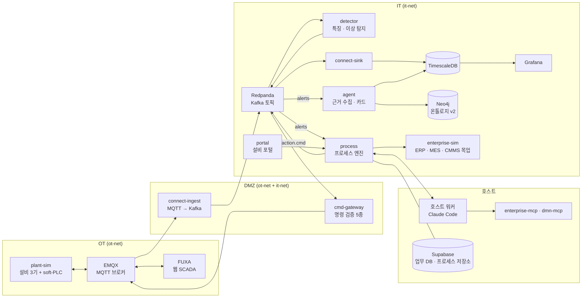

# hyd-iot-edu 아키텍처 개요

유압설비 IoT-SCADA 구조(L1~L9, OT · DMZ · IT)를 학생 노트북에서 `docker compose up` 한 번으로 돌리는 교육용 프로토타입이다.
이 문서는 전체 구조를 한 장으로 요약한다. 기동 절차는 [RUNBOOK](RUNBOOK.md), 토픽 · 페이로드 상세는 [topics.md](topics.md), 현재 상태는 [handoff/NOW.md](handoff/NOW.md)가 정본이다.

## 1. 한눈에 보기

경보 한 건이 설비에서 태어나 사람 승인을 거쳐 다시 설비 명령으로 돌아오는 폐루프다.



## 2. 계층 구성 (L1~L9)

| 층 | 구역 | 구성요소 | 역할 | 원래 설계의 제품 |
|---|---|---|---|---|
| L1 | OT | plant-sim | 설비 3기 물리 모델과 soft-PLC, 결함 주입 | hyd-sim · soft-plc · 고속 DAQ |
| L2 | OT | EMQX | MQTT 브로커 | EMQX · EdgeX |
| L3 | DMZ / IT | connect-ingest, cmd-gateway, Redpanda | OT↔IT 경계. 수집은 올리고 명령은 검증해서 내린다 | Kafka Connect · Apache Kafka |
| L4 | IT | detector | 1초 특징 계산, 경보 RAISE / CLEAR | Flink CEP + ONNX |
| L5 | IT | connect-sink, TimescaleDB | 시계열 · 경보 · 조치 · 감사 저장 | Kafka Connect JDBC Sink · TimescaleDB |
| L6 | OT / IT | FUXA, Grafana, Prometheus(선택) | 현장 화면, 추세, 지표 | 동일 |
| L7 | IT | Neo4j | 온톨로지 v2: BSC → 프로세스 → 리소스 → 설비 진단 → 조치 방법(SOP 스킬) · DMN 규칙 | Neo4j + n10s |
| L8 | IT / 호스트 | agent, 호스트 워커, enterprise-mcp · dmn-mcp | 원인 후보와 근거를 모아 조치 카드 2~3장 제시 | LangGraph · MCP · LiteLLM |
| L9 | IT / 호스트 | process, portal, enterprise-sim, Supabase | 처리 건(프로세스 인스턴스), 사람 승인, PLC · 기업 시스템 실행 | Process GPT · SAP · MES · CMMS |

가벼운 제품(EMQX, FUXA, Redpanda, TimescaleDB, Grafana, Neo4j, Supabase)은 실제 제품을 그대로 쓴다.
무거운 제품(Flink, Kafka Connect, EdgeX 등)은 **같은 이름과 같은 메시지 계약을 지키는 작은 파이썬 서비스**로 대신했다.
프로세스 엔진도 ProcessGPT를 설치하지 않고 그 데이터 모양(`proc_def` · `bpm_proc_inst` · `todolist` · `events`)을 따라 직접 구현했다.

## 3. 네트워크 구역

| 네트워크 | 붙는 서비스 | 의미 |
|---|---|---|
| `ot-net` | emqx, plant-sim, fuxa | 현장망 |
| `it-net` | redpanda, detector, timescaledb, neo4j, agent, process, portal 등 | 업무망 |
| `ot-net` + `it-net` | connect-ingest, cmd-gateway | DMZ. 두 망을 잇는 서비스는 이 둘뿐이다 |
| `sim-net` | plant-sim, process | 시뮬레이터 전용 연결 |

모든 포트는 `127.0.0.1`에만 열린다.

## 4. 데이터 흐름

**올라가는 길 (수집 → 탐지 → 저장)**

1. plant-sim이 MQTT `plant/{asset}/tag/{name}`으로 태그를 1 Hz 발행한다.
2. connect-ingest가 Kafka `plant.tag` · `plant.wave` · `plant.status`로 옮긴다.
3. detector가 `feat.1s`(특징)와 `alerts`(경보)를 만든다.
4. connect-sink가 토픽을 TimescaleDB에 적재하고, Grafana가 추세로 보여 준다.

**판단하는 길 (경보 → 카드 → 승인)**

5. `alerts` 한 건이 process에서 처리 건(프로세스 인스턴스) 하나를 연다.
6. 그 안에서 에이전트 작업 4개(진단 · 후보 · 규정 · 순위)가 돈다. Neo4j에서 원인 후보를, TimescaleDB에서 증거를, DMN 규칙에서 가드레일을 가져온다.
7. 담당자가 포털에서 카드를 골라 승인한다. 승인 권한은 역할로 정해진다.

**내려가는 길 (명령 → 실행 → 종결)**

8. process가 Kafka `action.cmd`를 발행한다.
9. cmd-gateway가 검증 5종을 통과한 명령만 MQTT `plant/{asset}/cmd/auto`로 내린다.
10. PLC가 실행하고 `status`로 ACK를 돌려준다.
11. 경보가 CLEAR되면 효과 확인(재관측) → 정비 요청(enterprise-sim) → 종결. 모든 단계가 `audit` 토픽에 남는다.

## 5. 설계 원칙

- **판단은 LLM이 바꾸지 않는다.** 카드 후보 · 순위 · 승인 권한은 온톨로지와 DMN 규칙의 산식으로 정한다. 시스템 내부 LLM은 카드 설명문만 쓴다.
- **승인 전 에이전트는 조회 · 계산 · 보고만 한다.** 실행은 사람 승인 1회 뒤 process가 한다.
- **OT로 가는 명령은 cmd-gateway 한 곳만 지난다.** PLC가 `REMOTE_MANUAL`이면 거부하고 사유를 감사 로그에 남긴다.
- **사건 한 건 = 프로세스 인스턴스 하나.** 그 안을 시스템 · 에이전트 · 규칙 · 사람 · 현장 task로 나눈다.
- **시간은 20배속이 기본**(`TIME_SCALE=20`)이며 plant-sim · detector · process · agent에 함께 적용한다.

## 6. 기동 단위 (Compose 프로필)

| 단계 | 프로필 | 올라가는 것 |
|---|---|---|
| M1 | `ot` | plant-sim, emqx, fuxa |
| M2 | `backbone` | redpanda, connect-ingest, connect-sink, timescaledb, grafana |
| M3 | `detect` | detector, cmd-gateway |
| M4 | `monitor` (선택) | prometheus |
| M5 | `knowledge` | neo4j, kg-seed |
| M6 | `agent` + `enterprise` | agent, enterprise-sim |
| M7 | `process` | process, portal, effects-mcp |
| 추가 | `cliagents` | enterprise-mcp, dmn-mcp |
| 선택 | `tools` | redpanda-console |

기본값은 M4 · `cliagents` · `tools`를 뺀 7개 프로필이다. Supabase(`it/supabase`, `supabase start`)와 호스트 워커(`scripts/run_worker_host.sh`)는 compose 밖에서 따로 켠다.

## 7. 저장소 구조

```
compose.yaml        전체 서비스 정의
common/hydcommon/   토픽 이름 · 페이로드 스키마 · MQTT/Kafka 헬퍼 (모든 서비스 공용)
ot/                 plant-sim, fuxa
dmz/                connect-ingest, cmd-gateway
it/                 detector, connect-sink, timescaledb, grafana, neo4j, agent, process,
                    enterprise-sim, portal, agent-worker, *-mcp, supabase
scripts/            회귀 러너, 시나리오 증거 수집, 호스트 워커 기동
tests/              단위 테스트 (pytest)
students/           학생 실습용 템플릿 · 플로우
course/             강의 덱, 낭독 대본, 실습 랩
production/         교육 산출물 제작용 원고 · 도구
docs/               RUNBOOK, 회차별 절차(sessions/), 인계 기록(handoff/), 온톨로지 설계(ontology/)
```
