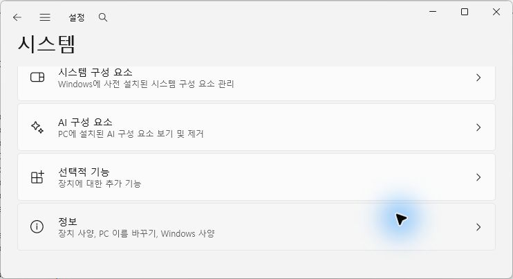
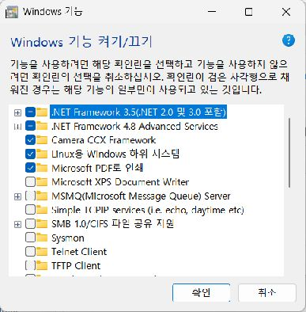

# 학교 Windows PC: Hyper-V 먼저 시도하고, 안 되면 WSL 권한 복구

**전제: 이 학교 PC는 WSL 설치에 실패했다. WSL 설치를 바로 반복하지 않고 Hyper-V 사용 가능 여부부터 확인한다. Hyper-V를 사용할 수 없거나 실제 실행에 실패하면 8번에서 기존 WSL 오류의 서비스·레지스트리 권한을 복구한다.**

순서: **관리자 PowerShell → Windows 에디션 → Hyper-V·가상화 → Docker 설치 형태 → Hyper-V 방식 전환 → Docker 검증 → 성공하면 시작·점검 / 실패하면 WSL 권한 복구**.

| 지금 확인된 상태 | 실행할 순서 |
|---|---|
| 아직 학교 PC의 Hyper-V 상태를 모름 | **1번 에디션 → 2번 Hyper-V 확인** |
| Hyper-V가 꺼져 있고 지원 에디션임 | **3번 활성화·재부팅 → 4번 Docker 설치 형태 → 5번 Docker 설정** |
| Hyper-V가 이미 켜져 있음 | **4번 Docker 설치 형태 → 5번 Docker 설정 → 6번 검증** |
| Hyper-V로 Docker 실행 성공 | **7번 시작·점검. 8번은 실행하지 않음** |
| Home·Hyper-V 사용 불가·Docker 전환/실행 실패 | **8-1 서비스 확인 → 필요하면 8-2 레지스트리 백업·권한 복구 → 8-3 WSL 설치 → 8-4 Docker 검증 → 7번 점검** |
아래를 전부 한꺼번에 실행하지 않는다. **1~4번은 확인용**이며, 그 결과에 따라 필요한 단계만 실행한다. 이 문서는 현장에서 실행할 절차이며 학교 PC의 복구 성공 기록은 아니다.

## 0. 시작 전 준비

재부팅하면 초기화되는 PC라면 강의실 관리자에게 **복원 기능 해제 또는 변경 사항을 유지할 방법**을 먼저 확인한다. 이를 준비하지 않으면 재부팅 후 같은 작업을 다시 해야 할 수 있다.

시작 메뉴에서 **Windows PowerShell 검색 → 관리자 권한으로 실행 → 사용자 본인이 ‘예’ 선택**. 제목에 `관리자`가 있는 창을 사용한다. 이후 재부팅 전까지 명령어는 이 창에서 실행한다.

## 1. Windows 에디션 확인

화면으로 확인하려면 **설정 → 시스템 → 맨 아래 ‘정보’**를 누른다. 아래는 사용자님 PC에서 직접 클릭해 촬영한 실제 화면이다.



**‘에디션’ 줄만 확인한다.** 사용자님 PC는 Home이다. 학교 PC에서도 같은 위치를 확인하되, 결과가 같다고 가정하지 않는다.


**실행할 명령 — 조회만 수행:**

```powershell
Get-CimInstance Win32_OperatingSystem | Format-List Caption,Version,BuildNumber
```

**결과를 보고 선택:**

- `Windows 11 Pro`, `Education`, `Enterprise` 계열: **2번으로**. 현재 Docker가 지원하는 Windows 빌드인지도 공식 요구 사항에서 확인한다.
- `Windows 11 Home`: **Hyper-V 경로를 생략하고 8번 WSL 복구로 이동**. Home에 Hyper-V를 강제로 설치하는 우회는 진행하지 않는다.

사용자님 개인 PC는 Home이었지만 **학교 PC 에디션은 별도로 확인해야 한다.**

## 2. Hyper-V 기능과 하이퍼바이저 확인

화면으로 조회하려면 다음 명령으로 Windows 기능 창을 열 수 있다. **확인하거나 체크하지 말고 목록만 본다. 닫을 때는 취소**를 누른다.

```powershell
optionalfeatures.exe
```

아래는 사용자님 Home PC에서 직접 연 실제 화면이다. **Hyper-V 항목이 없다.** 학교 PC가 지원 에디션이면 목록이 다를 수 있다. ‘Linux용 Windows 하위 시스템’ 체크는 Hyper-V 기능이 켜졌다는 뜻이 아니다.



**먼저 아래 명령 전체를 실행 — 조회만 수행:**

```powershell
Get-WindowsOptionalFeature -Online |
    Where-Object { $_.FeatureName -in @('Microsoft-Hyper-V-All', 'Microsoft-Hyper-V-Hypervisor', 'Containers') } |
    Format-Table FeatureName,State
```

**다음 명령 실행 — 조회만 수행:**

```powershell
Get-CimInstance Win32_ComputerSystem | Format-List HypervisorPresent
```

| 결과 | 다음 행동 |
|---|---|
| Hyper-V와 Containers 모두 `Enabled`, `HypervisorPresent : True` | 기능 활성화는 필요 없다. **4번으로** |
| 하나라도 `Disabled` | **3번**에서 활성화 |
| `EnablePending` 또는 `EnabledPending` 등 적용 대기 상태 | 열린 작업 저장 → `Restart-Computer` 실행 → 재부팅 후 관리자 PowerShell에서 **1·2번 다시 확인** |
| Hyper-V 기능 항목이 전혀 안 나옴 | 에디션·Windows 구성을 확인. 지원 여부를 확인하고 사용할 수 없으면 **8번으로**. 다음 활성화 명령을 강행하지 않는다 |
| Hyper-V가 `Enabled`지만 `HypervisorPresent : False` | **3-2번**의 BIOS·부팅 상태 확인 |

**주의:** `HypervisorPresent=True` 하나만으로 Docker Hyper-V를 쓸 수 있다고 판단하지 않는다. Windows Home도 WSL·보안 기능 때문에 True일 수 있다. **1번 에디션과 2번 기능 상태를 함께 본다.**

## 3. Hyper-V가 꺼졌을 때만 활성화

### 3-1. 필요한 기능 활성화

**실행 조건:** 1번에서 지원 에디션이고, 2번에서 필요한 기능이 Disabled인 경우. 이미 모두 Enabled이면 생략한다.

먼저 BIOS 가상화를 조회한다.

```powershell
Get-CimInstance Win32_Processor | Format-List Name,VirtualizationFirmwareEnabled
```

하이퍼바이저가 False이고 BIOS 가상화도 False이면 **작업 관리자 → 성능 → CPU → 가상화**를 확인한다. 실제로 꺼져 있으면 PC 관리자와 BIOS/UEFI의 Intel VT-x 또는 AMD SVM을 먼저 켠다. BIOS 메뉴는 PC 제조사별로 달라 공통 PowerShell 명령으로 켤 수 없다.

**가상화가 준비됐으면 실행 — Windows 기능 변경:**

```powershell
Enable-WindowsOptionalFeature -Online -FeatureName Microsoft-Hyper-V,Containers -All -NoRestart -ErrorAction Stop
```

오류 없이 끝나면 열린 작업을 저장한다. 재부팅 복원 기능이 해제됐는지 확인한 뒤 실행한다.

```powershell
Restart-Computer
```

**재부팅 후 관리자 PowerShell을 다시 열고 1·2번을 확인한다.** 기능이 Enabled이고 하이퍼바이저가 True이면 4번으로 간다. 기능 활성화에서 액세스 거부 등 오류가 나오면 해당 오류를 기록하고 **8번 WSL 복구로 이동**한다. 학교 관리 정책이 두 경로 모두를 막는 경우에는 관리자의 조치가 필요하다.

### 3-2. Hyper-V는 Enabled인데 하이퍼바이저가 False인 경우만

BIOS 가상화가 켜져 있는지 위 방법으로 확인하고, 관리자 PowerShell에서 부팅 설정을 조회한다.

```powershell
bcdedit.exe /enum '{current}'
```

결과에 **`hypervisorlaunchtype Off`가 명시적으로 있을 때만** 다음을 실행한다. 항목이 없다고 Off로 판단하지 않는다.

```powershell
bcdedit.exe /set hypervisorlaunchtype auto
```

성공하면 작업을 저장하고 재부팅한다.

```powershell
Restart-Computer
```

재부팅 후 2번을 다시 조회한다. 여전히 False이면 BIOS·부팅·학교 관리 설정을 확인해야 하며 Docker 설정만으로 해결할 수 있는 상태가 아니다.

## 4. Docker가 Hyper-V 지원 방식으로 설치됐는지 확인

**첫 번째 명령 — 전체 사용자용 기본 설치 경로 확인:**

```powershell
Test-Path -LiteralPath "$env:ProgramFiles\Docker\Docker\Docker Desktop.exe"
```

**두 번째 명령 — 사용자 전용 기본 설치 경로 확인:**

```powershell
Test-Path -LiteralPath "$env:LOCALAPPDATA\Programs\DockerDesktop\Docker Desktop.exe"
```

**세 번째 명령 — Docker 지원 서비스 확인:**

```powershell
Get-Service -Name 'com.docker.service','LanmanServer' -ErrorAction SilentlyContinue |
    Format-Table Name,Status,StartType
```

| 결과 | 다음 행동 |
|---|---|
| 첫 명령 `True`, `com.docker.service`가 있음 | 일반적인 전체 사용자용 설치. **5번으로** |
| 사용자 전용 경로만 `True`, Docker 서비스 없음 | 현재 설치 형태에서는 Hyper-V 사용 불가. 전체 사용자용 재설치를 준비하거나 **8번 WSL 복구로 이동** |
| 둘 다 `False` | Docker 없음 또는 사용자 지정 경로. Windows의 설치된 앱에서 실제 설치 위치·형태를 확인 |

경로 검사는 기본 경로 기준이다. 사용자 지정 경로가 있으면 이 결과만으로 설치 유무를 단정하지 않는다. 서비스가 `Stopped`인 것만으로 잘못 설치됐다고 판단하지 않는다.

**사용자 전용 설치인 경우:** 공식적으로 전체 사용자용 전환은 제거 후 재설치가 필요하다. 이 문서에서 데이터 삭제·초기화를 자동 실행하지 않는다. 설치 프로그램에서 **전체 사용자용(All users)**과 Hyper-V 백엔드를 선택하도록 학교 관리자와 준비한다. 준비 후 이 문서의 4번부터 다시 확인한다.

## 5. Docker를 Hyper-V 방식으로 전환

**실행 조건:** Hyper-V가 준비됐고 Docker가 전체 사용자용으로 설치된 경우.

**Docker Desktop 열기:**

```powershell
Start-Process -FilePath "$env:ProgramFiles\Docker\Docker\Docker Desktop.exe"
```

**이 부분은 Docker 화면에서 직접 클릭한다:**

1. 오른쪽 위 **설정(톱니바퀴)**.
2. **General**.
3. **Use the WSL 2 based engine**의 체크를 **해제**.
4. **Apply & Restart**. 관리자 승인 창이 나오면 사용자 본인이 승인.
5. Docker 엔진이 시작될 때까지 기다린 뒤 **6번** 실행.

체크 항목이 없거나 비활성화됐다면 1~4번 조건·설치 형태를 확인한다. 전환 불가 또는 오류가 해결되지 않으면 오류를 기록하고 **8번 WSL 복구로 이동**한다. **Switch to Windows containers는 선택하지 않는다. 이 프로젝트는 Linux 컨테이너를 사용한다.**

### 5-1. 오류가 Server 서비스를 지목하는 경우만

4번에서 `LanmanServer`가 Disabled 또는 Stopped였고 Docker도 해당 서비스 문제를 표시하면, 관리자와 확인한 뒤 아래를 **한 줄씩** 실행한다. 오류가 나면 다음 줄을 실행하지 않는다.

```powershell
Set-Service -Name LanmanServer -StartupType Automatic -ErrorAction Stop
```

```powershell
Start-Service -Name LanmanServer -ErrorAction Stop
```

이후 Docker Desktop에서 엔진 시작을 다시 시도한다.

## 6. Docker 실행 검증

**새 PowerShell 창**을 열고 아래 명령을 실행한다.

```powershell
docker version
```

**정상 결과:** `Client`와 `Server`가 모두 출력된다. Server 연결 오류가 나면 아직 정상 실행이 아니다. 엔진 시작을 기다려 한 번 재확인하고, 계속 실패하면 오류를 기록한 뒤 **8번으로 이동**한다.

그다음 실행한다.

```powershell
docker info --format '{{.OSType}}'
```

**정상 결과:** `linux`. `windows`이면 Docker 메뉴에서 Linux containers로 전환한 뒤 재확인한다.

### 6-1. docker 명령을 찾지 못하는 경우만

전체 사용자용 기본 경로라면 직접 호출한다.

```powershell
& "$env:ProgramFiles\Docker\Docker\resources\bin\docker.exe" version
```

```powershell
& "$env:ProgramFiles\Docker\Docker\resources\bin\docker.exe" info --format '{{.OSType}}'
```

**Client·Server와 linux가 확인되면 Docker Linux 엔진 응답 확인 완료.** 백엔드는 5번 설정에서 확인한다. 다음은 프로젝트 실습 스택 검증이다.

## 7. 시작.bat과 점검.bat 실행

**현재 설치.bat은 WSL 설치를 시도하므로 이 경로에서 전체 설치.bat을 반복 실행하지 않는다.** 이미 나머지 도구가 설치된 학교 PC에서는 아래 실행·점검으로 진행한다. 시작.bat은 Git for Windows의 Bash를 사용하며 WSL 설치 명령을 호출하지 않는다.

새 PowerShell에서 먼저 나머지 도구가 응답하는지 확인한다.

```powershell
git --version
```

```powershell
python --version
```

```powershell
node --version
```

Python 명령만 없으면 `py --version`도 확인한다. 특정 버전으로 맞추려고 기존 프로그램을 지우거나 덮어쓰지 않는다. 프로그램이 실제로 빠졌다면 해당 도구를 먼저 준비한다. 기존 Python·Anaconda는 유지한다.

학교 PC의 실제 저장소 폴더로 이동한다. 아래는 현재 대화에서 사용한 경로의 예다.

```powershell
Set-Location -LiteralPath 'C:\uengine\hyd-iot-edu'
```

```powershell
.\시작.bat
```

**시작 완료 메시지를 확인한 다음에만** 실행한다.

```powershell
.\점검.bat
```

Docker Linux 엔진 실행과 전체 실습 스택 검증은 별개다. 점검 실패 항목이 없어야 현장 실행 검증 완료로 판단한다. 필요한 접속 키는 공개 문서나 저장소에 넣지 않는다.

마지막으로 재부팅 후 설정이 유지되고 Docker·실습 스택이 정상인지 확인한다. 강의실 관리자와 정상 상태를 복구 기준 또는 배포 이미지로 저장한다.

## 8. Hyper-V를 사용할 수 없거나 실행 실패 → WSL 권한 복구

**이 단계는 Hyper-V 경로가 막힌 경우에만 실행한다.** 이미 Docker가 정상 실행되면 생략한다. 기존 WSL 설치는 실패했으므로 같은 설치 명령부터 반복하지 않는다.

### 8-1. Windows Update 서비스부터 확인

**학교 PC의 관리자 Windows PowerShell에서 실행 — 조회:**

```powershell
Get-Service -Name wuauserv,BITS,msiserver -ErrorAction SilentlyContinue |
    Format-Table Name,Status,StartType
```

wuauserv가 Disabled이면 아래 첫 줄을 실행한다. 이미 Manual 또는 Automatic이면 첫 줄을 생략한다.

```powershell
Set-Service -Name wuauserv -StartupType Manual -ErrorAction Stop
```

- **오류 없이 끝남:** 아래 Start-Service 실행.
- **액세스 거부:** 여기서 멈추고 **8-2번**으로 이동. 권한 복구 후 돌아온다.

```powershell
Start-Service -Name wuauserv -ErrorAction Stop
```

```powershell
Get-Service -Name wuauserv | Format-Table Name,Status,StartType
```

**Running이고 시작 유형이 Manual 또는 Automatic이면 8-3번으로**. 서비스 시작 자체가 실패하면 오류 전문을 기록한다. 권한 변경만으로 그 오류가 해결된다고 단정하지 않는다. BITS·msiserver의 Manual/Stopped 표시만으로 장애로 판단하지 않는다.
### 8-2. Set-Service에서 액세스 거부일 때만 레지스트리 권한 복구

#### 8-2-1. 조회와 백업

```powershell
$ErrorActionPreference = 'Stop'
$keyPath = 'HKLM:\SYSTEM\CurrentControlSet\Services\wuauserv'
$keyAcl = Get-Acl -LiteralPath $keyPath
$keyAcl | Format-List Owner
$keyAcl.Access |
    Format-Table IdentityReference,RegistryRights,AccessControlType

$backupDir = Join-Path $env:USERPROFILE ('wuauserv-backup-' + (Get-Date -Format 'yyyyMMdd-HHmmss'))
New-Item -ItemType Directory -Path $backupDir | Out-Null
$keyAcl.Sddl | Set-Content (Join-Path $backupDir 'permissions-sddl.txt')
$keyAcl.Owner | Set-Content (Join-Path $backupDir 'original-owner.txt')
reg.exe export 'HKLM\SYSTEM\CurrentControlSet\Services\wuauserv' (Join-Path $backupDir 'wuauserv.reg') /y
if ($LASTEXITCODE -ne 0) { throw '레지스트리 값 백업 실패. 변경을 중단하세요.' }
Write-Host "백업 위치: $backupDir"
```

백업 오류가 나면 변경을 진행하지 않는다. `.reg`는 값의 백업이고 SDDL 파일이 권한 백업이다. `SYSTEM`과 `Administrators` 모두 `ReadKey`뿐인 상태가 학교 PC 사진에서 확인됐다. 이 경우 설정 변경이 거부될 근거가 있다. 이미 권한이 정상이면 아래 변경을 적용하지 않는다.

#### 8-2-2. GUI에서 필요한 키만 수정

**화면 확보 상태:** 사용자님 PC의 레지스트리 편집기까지 열었으나 관리자 창에 자동 클릭이 반영되지 않아, 아래 권한 편집 화면은 직접 촬영하지 못했다. 이 부분을 실제 화면 가이드 완료로 간주하지 않는다. 사용자님 PC의 권한은 변경하지 않았다.

관리자 PowerShell에서 편집기를 연다.

```powershell
regedit.exe
```

주소창에 다음을 입력한다.

```text
HKEY_LOCAL_MACHINE\SYSTEM\CurrentControlSet\Services\wuauserv
```

1. 왼쪽 **wuauserv 우클릭 → 사용 권한 → 고급**.
2. 권한 편집이 안 되고 소유자 변경이 필요하면, 기존 소유자를 기록한 뒤 **소유자 옆 변경 → Administrators 입력 → 이름 확인 → 확인 → 적용**. 이미 Administrators로 바꿨다면 반복하지 않는다.
3. 창을 닫고 사용 권한 → 고급으로 다시 들어간다.
4. **Administrators 선택 → 편집 → 유형: 허용 / 적용 대상: 이 키만 / 모든 권한 → 확인**.
5. **SYSTEM**에도 같은 설정. 대상이 없거나 상속 항목이라 편집이 안 되면 **추가 → 보안 주체 선택**에서 해당 대상을 선택해 `이 키만` 적용하는 허용 항목을 추가한다.
6. 두 항목 확인 후 **적용 → 확인**.

**소유자 변경만으로 작업이 끝나지 않는다. 수정 권한도 별도로 필요하다.** Everyone·Users와 상위 Services 전체 권한은 변경하지 않는다. 하위 개체 소유자 변경·모든 자식 개체 권한 교체는 체크하지 않는다. 거부 항목을 임의 삭제하거나 상속을 일괄 변경하지 않는다.

적용이 거부되거나 권한이 즉시 되돌아가면 오류를 기록하고 PC 관리자와 차단 프로그램·관리 정책 여부를 확인한다. 어떤 프로그램이 원인인지는 현재 확인되지 않았다.

복구 후 8-1번 서비스 명령을 다시 한 줄씩 실행한다. `Running`이고 시작 유형이 `Manual` 또는 `Automatic`이면 8-3번으로 이동한다. 이 복구만으로 모든 WSL 설치 문제가 해결된다고 보장할 수는 없다.

### 8-3. 권한·서비스를 처리한 후 Windows 기능과 WSL 설치

**관리자 PowerShell**에서 필요한 Windows 기능을 활성화한다. 이 명령은 설정을 변경한다.

```powershell
Enable-WindowsOptionalFeature -Online -FeatureName Microsoft-Windows-Subsystem-Linux,VirtualMachinePlatform -All -NoRestart -ErrorAction Stop
```

오류가 나면 중단하고 해당 오류를 확인한다. 성공하면 다른 설치가 진행 중이지 않은 상태에서 실행한다.

```powershell
wsl.exe --install --web-download --no-distribution
```

**설치 성공 후**, 열린 작업을 저장하고 재부팅 복원 기능이 해제됐는지 확인한 뒤 재부팅한다. 실패한 상태에서 성공으로 간주해 다음 단계로 넘어가지 않는다.

```powershell
Restart-Computer
```

재부팅 후 PowerShell에서 실행한다.

```powershell
wsl.exe --version
```

```powershell
wsl.exe --status
```

버전 정보가 정상 표시되는지 확인한다. 배포판이 없다는 안내만으로 설치 실패라고 판단하지 않는다. Docker용 Ubuntu 배포판을 추가할 필요는 없다.

### 8-4. Docker를 WSL 2 방식으로 설정하고 검증

시작 메뉴에서 Docker Desktop을 연다. 사용자 전용 기본 경로이면 아래 명령으로도 열 수 있다.

```powershell
Start-Process -FilePath "$env:LOCALAPPDATA\Programs\DockerDesktop\Docker Desktop.exe"
```

전체 사용자용 기본 경로이면 5번의 실행 명령을 사용한다. 실제 설치 경로에 해당하는 명령 **하나만** 사용한다.

Docker **설정 → General → Use the WSL 2 based engine 체크 → Apply & Restart**. WSL 전용 설치라 항목이 표시되지 않으면 엔진 시작 결과로 확인한다.

새 PowerShell 창에서 실행한다.

```powershell
 docker version
```

```powershell
 docker info --format '{{.OSType}}'
```

Client·Server와 linux가 나오면 **7번의 시작·점검**으로 돌아간다. WSL 설치나 Docker 실행이 계속 실패하면 정확한 오류를 기록해 PC 관리자와 확인한다. 같은 설치·권한 변경을 반복하지 않는다.

## 공식 근거

- [Microsoft: Hyper-V 활성화·지원 조건](https://learn.microsoft.com/en-us/windows-server/virtualization/hyper-v/get-started/install-hyper-v?pivots=windows)
- [Docker: Windows 설치 형태·Hyper-V 요구 사항](https://docs.docker.com/desktop/setup/install/windows-install/)
- [Docker: 설정 항목](https://docs.docker.com/desktop/settings-and-maintenance/settings/)
