# WSL 오류: 레지스트리 권한 화면 따라가기

[전체 진행 순서와 명령어로 돌아가기](Windows_Docker_설치.md)

**이 사진들은 사용자님 PC에서 실제 창을 열고 직접 촬영했다.** 촬영 과정에서 소유자·권한·레지스트리 값은 저장하거나 변경하지 않았고, 입력창은 취소로 닫았다. 실제 복구는 학교 PC에서 백업 후 수행한다.

학교 PC는 SYSTEM과 Administrators 모두 읽기 권한만 있었지만, **사진의 개인 PC는 이미 정상 권한을 갖고 있다.** 사진은 창과 버튼의 위치를 보는 용도다. 회색 보기 전용 화면을 복구 후의 학교 PC 상태라고 해석하지 않는다.

이 절차는 **Hyper-V 경로를 사용할 수 없고, WSL 복구에서 Set-Service가 액세스 거부로 실패한 경우에만** 진행한다. [변경 전 백업](Windows_Docker_설치.md#8-2-1-조회와-백업)을 먼저 완료한다.

## 화면 1. 정확한 경로 열기

학교 PC의 관리자 PowerShell에서 `regedit.exe`를 실행한다. 위쪽 주소창에 아래 경로를 붙여 넣고 Enter를 누른다.

```text
HKEY_LOCAL_MACHINE\SYSTEM\CurrentControlSet\Services\wuauserv
```

**확인할 곳:** 위쪽 경로 끝과 왼쪽 선택 항목이 모두 `wuauserv`여야 한다. 오른쪽 Start 등의 값을 직접 수정하지 않는다.

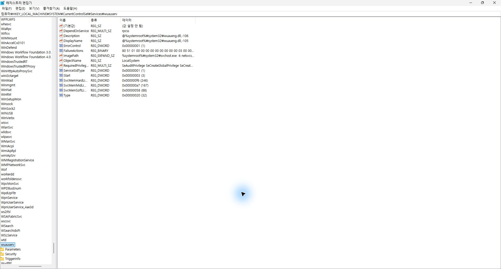

## 화면 2. 사용 권한 메뉴

왼쪽 **wuauserv를 마우스 오른쪽 버튼으로 클릭**한다. 나타난 메뉴에서 **사용 권한(P)…**을 누른다.

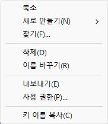

## 화면 3. 고급 버튼

창 아래쪽 오른편의 **고급(V)**을 누른다. 이 화면에서 Everyone이나 다른 계정의 체크를 바꾸지 않는다.

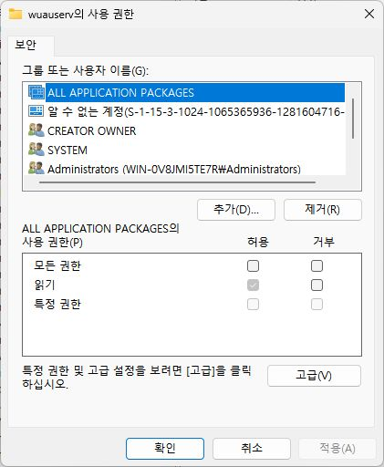

## 화면 4. 소유자와 현재 권한 보기

위쪽에는 **소유자**, 가운데에는 **Administrators·SYSTEM**, 아래에는 **추가·보기·취소·적용**이 있다.

사진의 개인 PC는 이미 모든 권한이 있다. **학교 PC도 이미 필요한 권한이 있으면 권한 복구를 반복하지 않는다.**

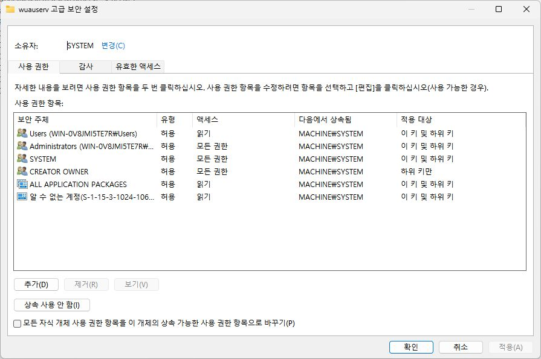

## 화면 5. 소유자 변경 창

학교 PC에서 권한 편집을 위해 소유자 변경이 필요한 경우에만 위쪽 **변경(C)**을 누른다. 이미 소유자를 Administrators로 바꿨다면 화면 8로 이동한다.

**선택할 개체 이름**이라는 큰 입력칸에 `Administrators`를 입력한다.

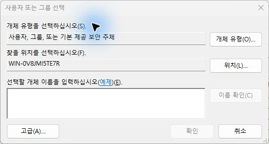

## 화면 6. 이름 입력 → 이름 확인

아래처럼 입력한 뒤 오른쪽 **이름 확인(C)**을 누른다.

```text
Administrators
```

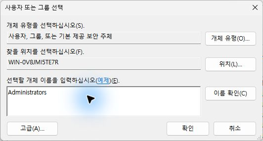

## 화면 7. 밑줄이 생기면 이름 확인 성공

`컴퓨터이름\Administrators`처럼 **밑줄**이 생기면 대상이 확인된 것이다. 사진의 컴퓨터 이름을 그대로 입력할 필요는 없다.

**실제 복구 중인 학교 PC에서는:** 확인 → 고급 보안 설정에서 소유자 확인 → 적용. 하위 개체의 소유자를 함께 바꾸는 체크는 하지 않는다.

**이번 촬영에서는:** 이름 확인 결과만 촬영하고 취소했다. 소유자는 변경하지 않았다.

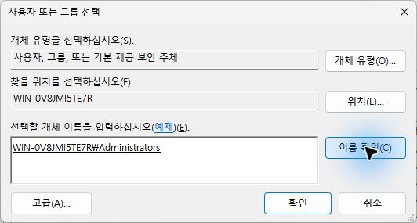

## 화면 8. Administrators 권한 항목 열기

학교 PC에서 소유자 변경을 적용했다면 창을 닫았다가 **사용 권한 → 고급**으로 다시 들어간다. 가운데 목록의 **Administrators** 줄을 더블클릭한다.

사진은 기존 상속 항목을 **보기 전용**으로 연 화면이다. 여기서 확인할 위치는 위쪽 **보안 주체·유형·적용 대상**과 가운데 **모든 권한**이다.

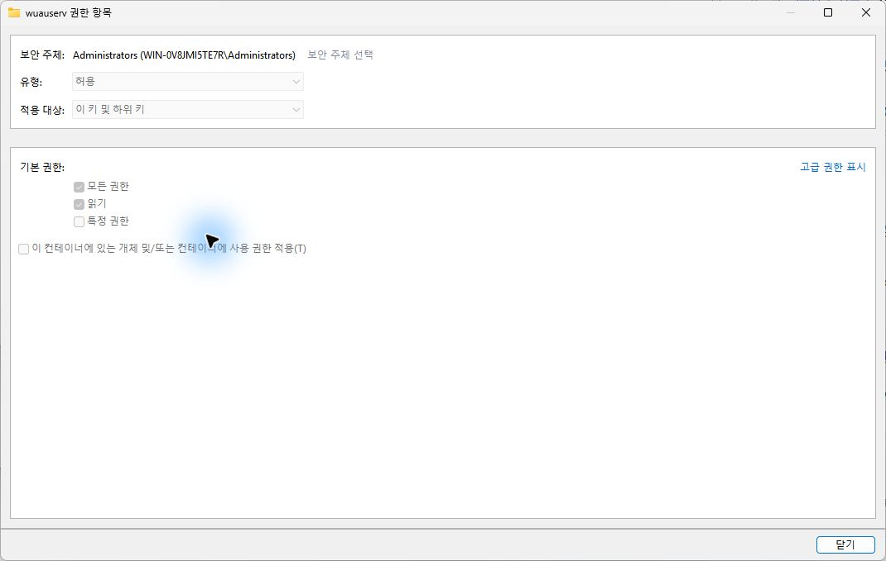

학교 PC에서 **편집할 수 있는 항목**이라면 다음과 같이 설정한다.

| 위치 | 학교 PC에서 설정할 값 |
|---|---|
| 보안 주체 | Administrators |
| 유형 | 허용 |
| 적용 대상 | **이 키만** |
| 기본 권한 | **모든 권한** |

**사진처럼 회색이고 보기 전용이면:** 상속을 끄거나 상위 키 권한을 바꾸지 않는다. 닫기를 누르고 화면 10의 **추가** 경로를 사용한다.

## 화면 9. SYSTEM 권한도 확인

Administrators 상세 창을 닫고, 고급 보안 설정 목록에서 **SYSTEM**을 더블클릭한다.

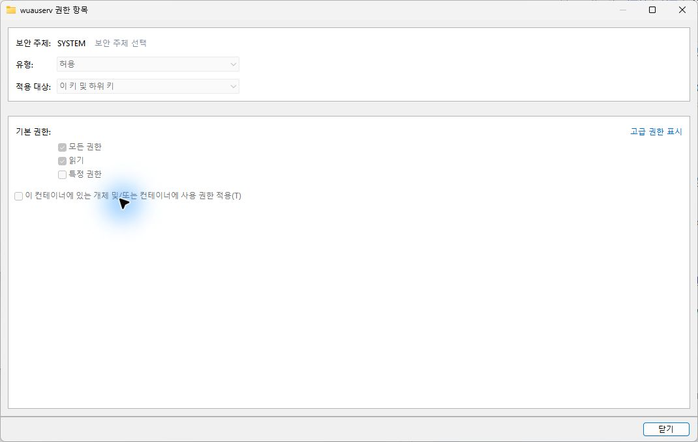

학교 PC에서 복구할 값은 **SYSTEM / 허용 / 이 키만 / 모든 권한**이다. 기존 항목이 보기 전용이면 다음의 추가 경로를 사용한다.

## 화면 10. 기존 항목을 편집할 수 없을 때의 추가 경로

고급 보안 설정으로 돌아가 **추가(D)**를 누른다. 아래 입력창에서 **보안 주체 선택**을 누른다.

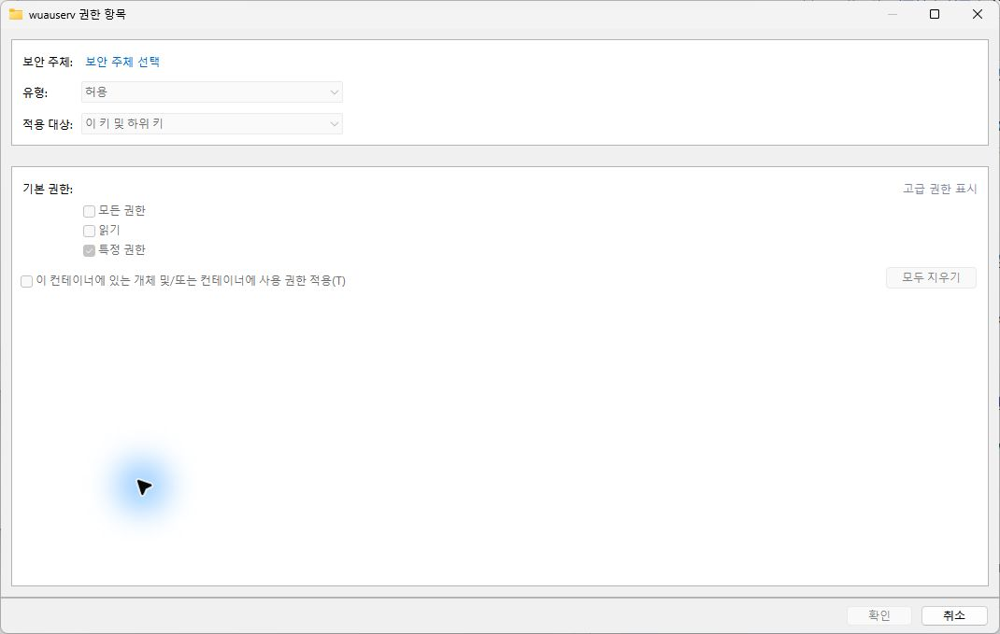

이름 선택 창은 화면 5~7과 같은 형태다. 먼저 `Administrators` 입력 → 이름 확인 → 확인을 누른다. 권한 항목 창으로 돌아와 다음 세 항목을 설정한다.

1. **유형: 허용**.
2. **적용 대상: 이 키만**. 사진의 기본값인 ‘이 키 및 하위 키’를 그대로 쓰지 않는다.
3. **기본 권한: 모든 권한** 체크.

확인으로 항목을 추가한다. **SYSTEM도 같은 방법으로 한 번 더 추가**한다. 촬영에서는 보안 주체·권한 항목을 추가 저장하지 않고 취소했으므로 사진에는 기본 입력창 상태가 보인다.

## 화면 11. 마지막 확인 후 학교 PC에서 적용

실제 복구 중인 학교 PC에서는 가운데 목록에 필요한 두 항목이 있는지 확인한다. Everyone·Users는 변경하지 않는다.

- Administrators: 허용 / 모든 권한 / 이 키만
- SYSTEM: 허용 / 모든 권한 / 이 키만
- 아래쪽 **모든 자식 개체 사용 권한 항목…** 체크박스: **선택하지 않음**

확인한 뒤 **적용 → 확인**한다. 소유자만 바꾸고 끝내지 않는다.

아래는 **촬영을 마치고 취소하기 직전의 개인 PC 실제 화면**이다. 권한을 바꾸지 않아 적용 버튼이 비활성화되어 있다. 학교 PC 복구를 적용한 결과 사진은 아니다.

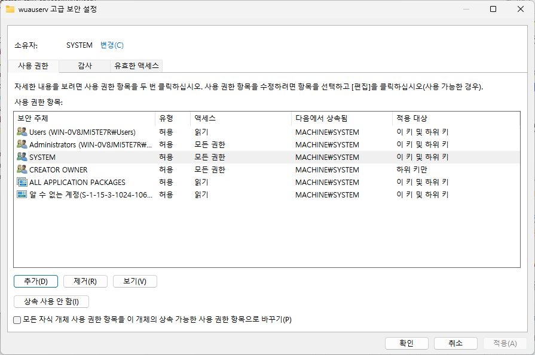

## 화면 절차가 끝나면 명령으로 확인

학교 PC의 **관리자 PowerShell**에서 한 줄씩 실행한다. 오류가 발생하면 다음 줄로 넘어가지 않는다.

```powershell
Set-Service -Name wuauserv -StartupType Manual -ErrorAction Stop
```

```powershell
Start-Service -Name wuauserv -ErrorAction Stop
```

```powershell
Get-Service -Name wuauserv | Format-Table Name,Status,StartType
```

`Running / Manual`이면 [전체 가이드의 8-3번](Windows_Docker_설치.md#8-3-권한서비스를-처리한-후-windows-기능과-wsl-설치)으로 돌아가 기능·WSL 설치를 진행한다. 계속 거부되거나 권한이 원래대로 돌아가면 오류와 관리 정책·차단 프로그램 여부를 확인해야 한다.
