# 학교 PC 설치 · 실행 확인

학생 PC 한 대에서 실습 스택이 끝까지 켜지고 도는지를 30분 안에 확인하는 순서다.
그림은 모두 2026-10-19에 클라우드(Linux)에서 스택을 실제로 띄워 진행한 순서대로 찍었다.
Windows 화면은 클라우드에서 찍을 수 없어 「자리」로 표시했다. 학교에서 처음 확인할 때 그 자리를 채운다.

## 0. 학생이 하는 일은 넷뿐이다

| 순서 | 할 일 | 걸리는 시간 |
|---|---|---|
| 1 | 설치 프로그램 7개를 설치한다(아래 표) | PC마다 다름 |
| 2 | 터미널에서 `git clone -b develop https://github.com/uengine-oss/hyd-iot-edu.git` | 1~2분 |
| 3 | 받은 폴더의 `시작.bat`을 더블클릭한다 | 처음 10분 이상, 두 번째부터 짧다 |
| 4 | (5회차 실습 때만) 실습 폴더 `.env`에 세 줄을 적는다 | 1분 |

끌 때는 `끄기.bat`을 더블클릭한다. 데이터는 지워지지 않는다.

**설치 프로그램 7개**

| 프로그램 | 확인할 것 |
|---|---|
| WSL2 | Docker Desktop보다 먼저 설치한다 |
| Docker Desktop | 메모리 4 GB 이상, 왼쪽 아래가 「Engine running」 |
| Git (Git for Windows) | `시작.bat`이 Git의 bash로 스크립트를 돌린다. 없으면 「Git for Windows가 없습니다」가 뜬다 |
| Python 3.14 | 5회차 실습의 `python llm_client.py`에 쓴다 |
| Node 22 + supabase CLI | `npm install -g supabase@2.119.0`. CLI가 없으면 `시작.bat`이 `npx`로 대신 받는다 |
| VS Code | 실습 폴더를 연다(GitHub Copilot 채팅 포함) |
| Notion | 수업 자료 열람 |

> **자리** — Windows에서 7개를 설치한 뒤의 Docker Desktop 「Engine running」 화면.
> 설치 목록의 정본은 강사가 가진 설치 xlsx다. 이 저장소에는 그 파일이 없어, 위 표는 그 목록의 이름만 옮겼다.

## A. 필수 확인 (약 30분)

### ① 시작.bat 결과: 단계 6개, 상태 10개, 「완료」

`시작.bat`을 더블클릭하면 검은 창에서 아래 순서가 지나간다. 마지막 줄이 `완료. 포털: http://127.0.0.1:8088`이면 된다.

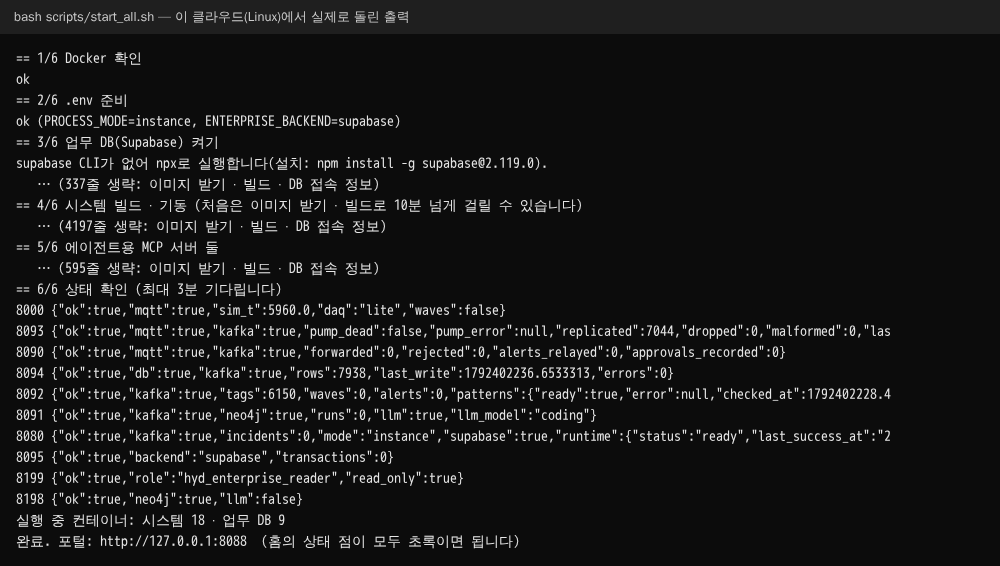

- 단계는 `1/6 Docker 확인` → `2/6 .env 준비` → `3/6 업무 DB(Supabase) 켜기` → `4/6 시스템 빌드 · 기동` → `5/6 에이전트용 MCP 서버 둘` → `6/6 상태 확인`이다.
- `6/6`에서 포트 10개(8000 · 8093 · 8090 · 8094 · 8092 · 8091 · 8080 · 8095 · 8199 · 8198)가 모두 `{"ok":true …}`로 나와야 한다.
- 컨테이너 수는 이 실행에서 시스템 18 · 업무 DB 9였다. 업무 DB 수는 supabase CLI 판에 따라 다를 수 있다.
- 그림의 `8091 … "llm":true,"llm_model":"coding"`은 이 클라우드 셸에 LLM 변수가 들어 있어서 나온 값이다. 학생 PC에서는 `"llm":false`가 정상이다. 실습 스택은 LLM 키 없이 끝까지 돈다.

> **자리** — Windows에서 `시작.bat`을 더블클릭한 창(마지막 「완료」 줄과 「계속하려면 아무 키나 누르십시오」).

### ② 포털 홈: 상태 점이 모두 초록

브라우저에서 `http://127.0.0.1:8088`을 연다.

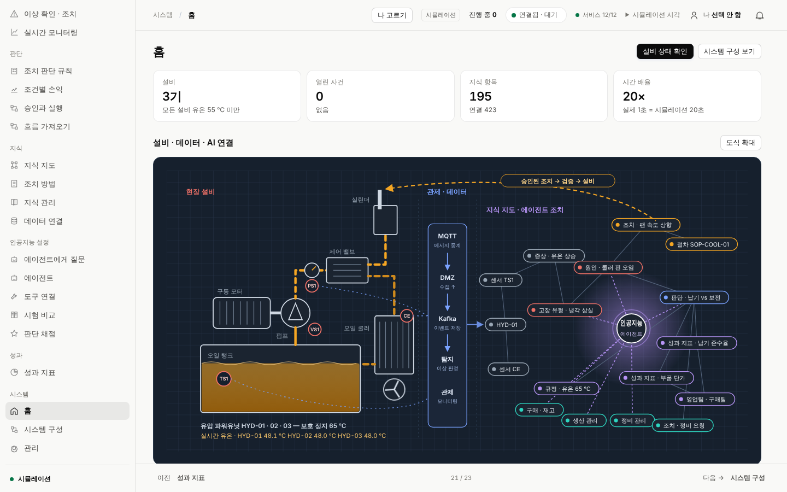

- 위 막대 오른쪽의 `서비스 12/12` 앞 점이 초록이면 된다.
- 왼쪽 메뉴 맨 아래 「시스템 구성」을 열면 서비스마다 점이 보인다. FUXA · Prometheus · Redpanda Console처럼 「(선택 도구)」라고 적힌 것은 꺼져 있어도 된다.

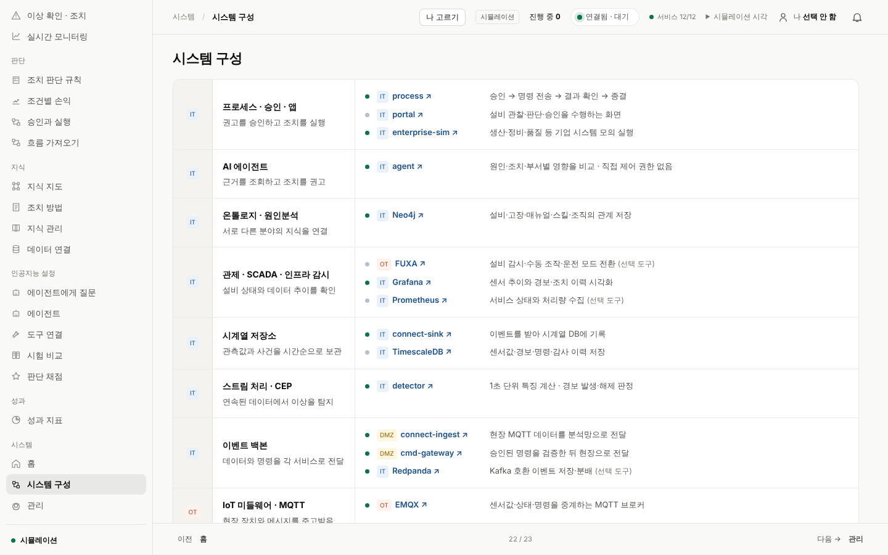

### ③ 쿨러 사건 한 바퀴

먼저 알아 둘 것이 있다. 새로 설치한 PC의 지식 그래프는 **수업용 구조판**이다(`SEED_EDITION=structure`, 설비 구조 · 센서 · 감시 패턴 · 규정만 들어 있다). 고장 원인과 조치 방법은 수업에서 학생이 매뉴얼을 적재해 만든다.
그래서 새 PC에서는 사건이 **「원인 진단 — 시스템 보류」에서 멈추는 것이 정상**이다. 승인 · 명령 · 종결까지는 지식이 들어 있어야 간다(③-2).

#### ③-1 새 PC 그대로: 경보 → 처리 건 → 진단 보류 (학생 PC에서 확인)

1. 왼쪽 「내 작업함」에서 **나**를 `김운전 · 운전원`으로 고른다.
2. 「결함 시뮬레이션」 → 오른쪽 위 **전체 초기화** → 20초쯤 기다린다. HYD-01 · 02 · 03 모두 유온 48.0 ℃, 경보 「감시 중」이 된다.

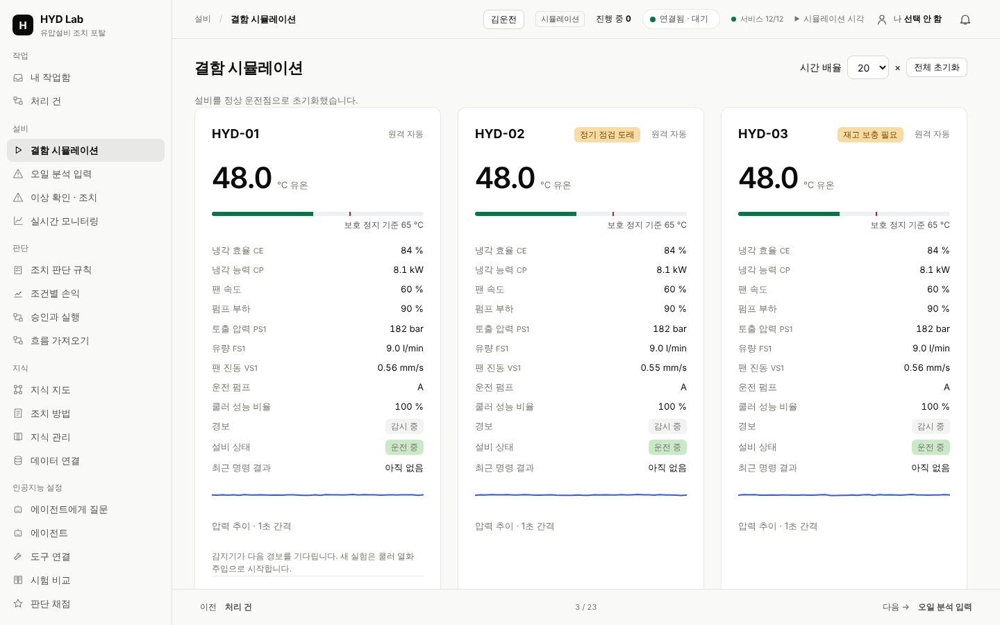

3. HYD-01 카드 아래 **쿨러 열화 주입**을 누른다. 이 실행에서는 약 40초 뒤 경보가 났다(유온 55.6 ℃, 냉각 효율 46 %). 카드의 경보 칸이 「경보 발생 · 쿨러 성능 저하」로 바뀐다.

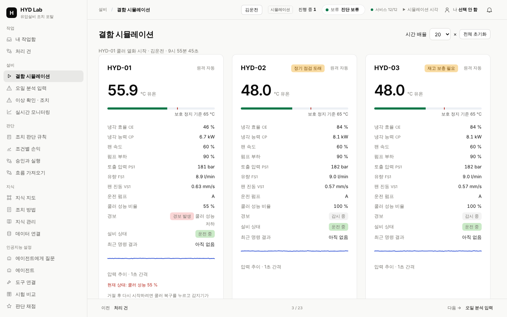

4. 「처리 건」을 연다. 새 건이 생기고, 몇 초 뒤 「지금 원인 진단 — 시스템 보류 · 사람 확인 필요」가 된다. **여기까지 오면 설치 확인은 통과다.** 설비 → 수집 → 감지 → 프로세스 → 에이전트 → 지식 그래프 · 시계열 DB가 모두 이어져 있다는 뜻이다.

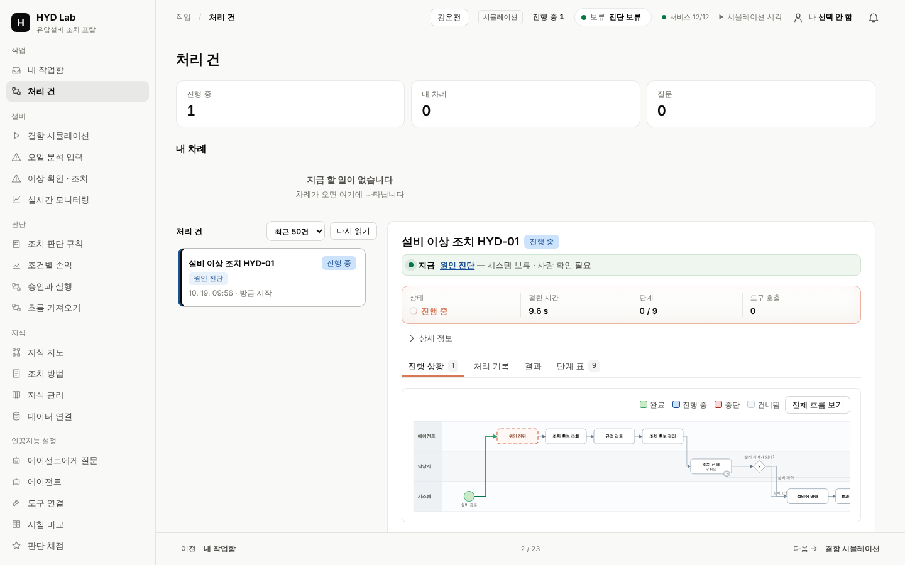

5. 「처리 기록」 탭에 「센서 경보로 시작 → 원인 진단」이 남는다. 보류한 까닭은 지식 그래프에 이 경보의 원인 후보가 없기 때문이다(「현재 관측 근거로 뒷받침되는 원인이 없어 조치를 보류합니다」).

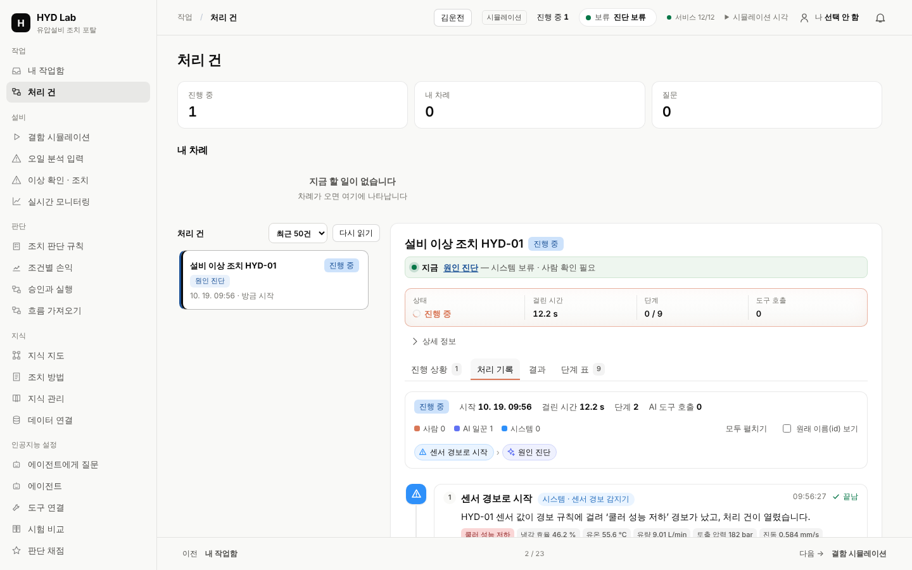

- 같은 시각 「이상 확인 · 조치」 화면은 이 사건을 「조치 선택 대기 · 조치 후보를 만드는 중…」으로 보여 준다. 처리 건 화면과 표시가 다르지만 고장이 아니다. 판단은 처리 건 화면을 따른다.
- 보류한 건은 그대로 두면 「책임자 확인」(생산관리자) 단계로 넘어간다(이 클라우드에서 09:43에 열린 건이 09:52에 그 단계였다).

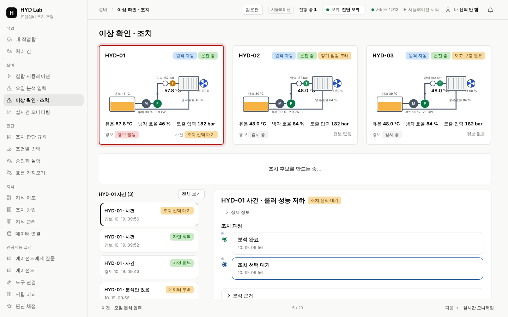

6. 확인이 끝나면 「결함 시뮬레이션」에서 **쿨러 복구**를 누른다.

#### ③-2 지식이 들어 있을 때: 승인 → 명령 → 재관측 → 종결 (강사 PC 확인용)

이 절은 원인 · 조치 지식이 들어 있는 **전체판**(`SEED_EDITION=full`, 회귀 시험과 같은 지식)을 더 적재한 뒤 같은 사건을 돌린 것이다. 학생 PC에서는 수업에서 매뉴얼을 적재한 뒤에 같은 모습이 된다.

1. **나**를 `이생산 · 생산관리자`로 고르고 「결함 시뮬레이션」에서 전체 초기화 → **쿨러 열화 주입**. 이 실행에서는 경보까지 약 40초 걸렸다.

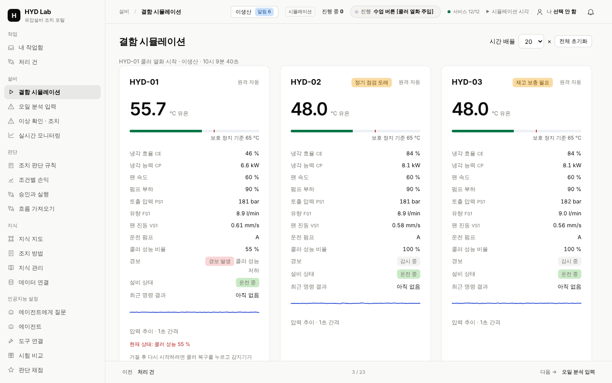

2. 에이전트 단계 넷(원인 진단 · 조치 후보 조회 · 규정 검토 · 조치 후보 정리)은 각각 1초 안팎에 끝났다. 「처리 건」의 **내 차례**에 「조치 선택」이 뜬다. 누르면 승인 요청 카드가 열린다. AI 에이전트 추천은 「부하 70 % + 야간 세척」이었다.

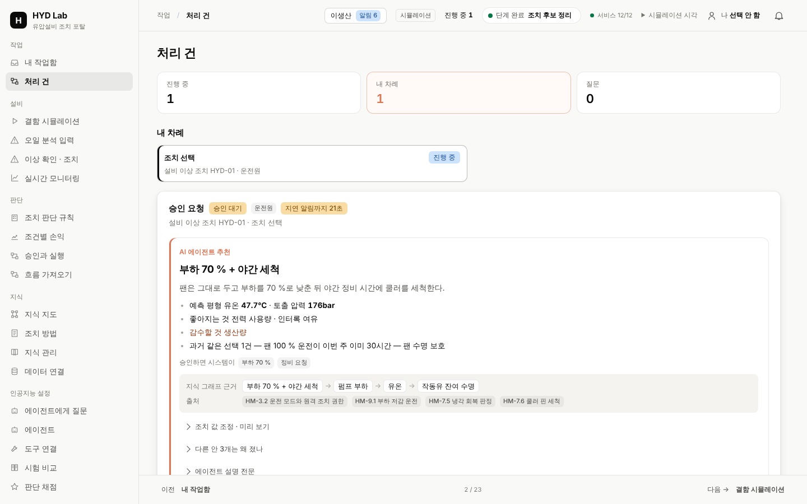

3. 맨 아래 **사유**에 한 줄을 적고 **승인**을 누른다.

> 이 추천 카드는 **생산관리자 이상**만 승인할 수 있다. 같은 화면에서 `김운전 · 운전원`으로 승인하면 아래처럼 거부된다. 이것은 정상이다(사람 승인 권한 검사).
>
> 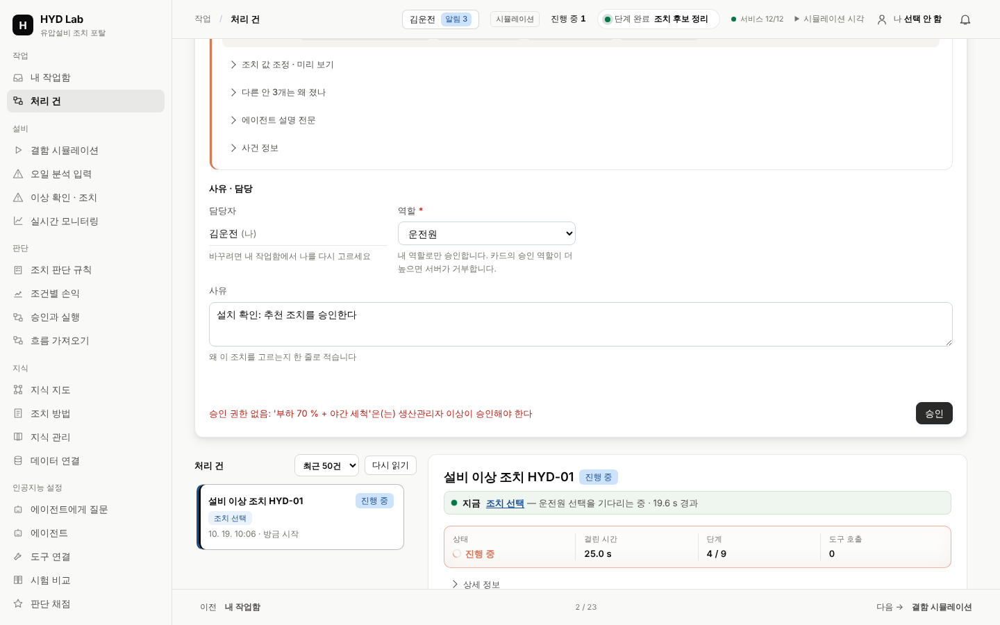
>
> 「조치 선택」은 운전원 공용 단계라 생산관리자의 「내 작업함」에는 뜨지 않는다. 생산관리자는 「처리 건」의 **내 차례**에서 연다.
> 승인 기한은 단계가 열린 뒤 **약 30초**다(흐름의 10분을 20배속으로 줄인 값, 이 클라우드 실측). 지나면 건이 「책임자 확인」으로 넘어가니, 카드가 뜨기 전에 「처리 건」을 열어 두고 바로 승인한다.

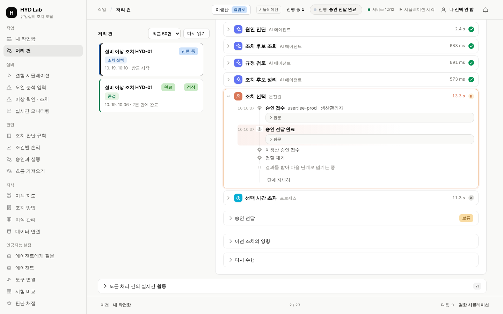

4. 승인 뒤 몇 초 안에 「설비에 명령」이 끝난다. 「결함 시뮬레이션」의 HYD-01에서 펌프 부하가 90 %에서 70 %로 바뀌고 「최근 명령 결과 완료」가 된다.

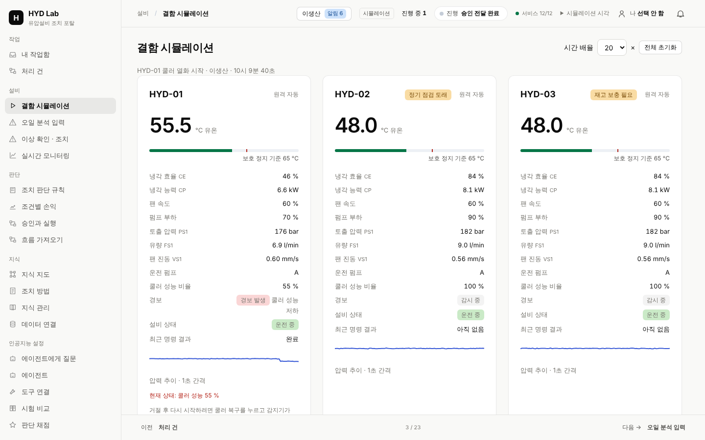

5. 효과 확인(재관측)과 정비 요청 등록이 이어지고 건이 **완료 · 종결**된다. 이 실행에서는 승인부터 종결까지 약 1분 걸렸고, 건 전체는 1분 7초였다.

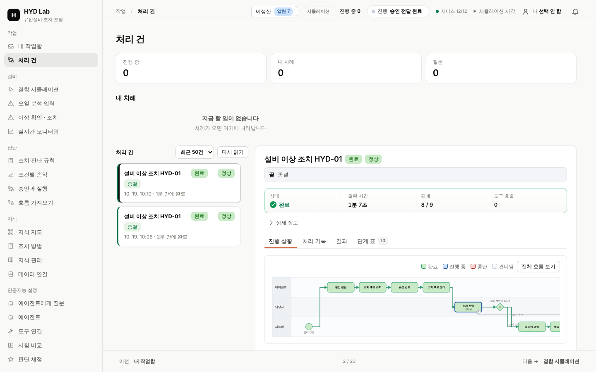

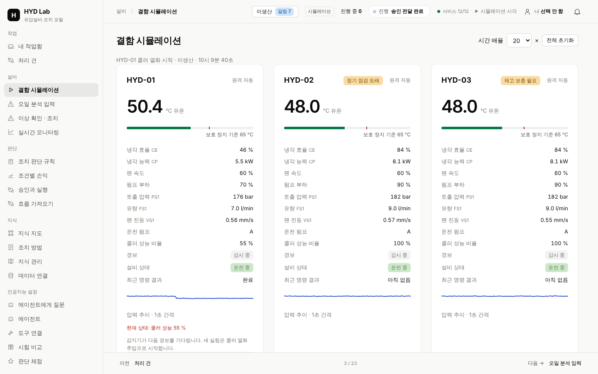

6. **쿨러 복구**를 누른다.

### ④ 5회차 실습 2 폴더: `python llm_client.py` → 「연결됨 · coding」

1. VS Code에서 `course/labs/offline/05-2-cause-agent` 폴더를 연다.
2. `.env`를 열어 등호 뒤에 적는다. 주소와 키는 수업에서 받은 것이다.

```
OPENAI_BASE_URL=<수업에서 받은 주소>
LLM_API_KEY=<수업에서 받은 키>
LLM_MODEL=coding
```

3. 저장한 뒤 터미널에서 `python llm_client.py`를 실행한다. 첫 줄이 `연결됨 · coding`이고 둘째 줄에 서버가 보낸 인사 한 문장이 나오면 된다.

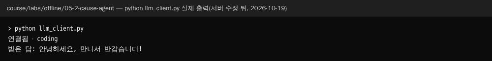

> **자리** — 같은 화면을 Windows VS Code 터미널에서 찍은 것.

값을 틀렸을 때는 아래처럼 고칠 곳을 알려 준다. 모두 이 클라우드에서 실제로 나온 글이다(맨 위 줄은 서버 쪽 키를 고치기 전의 상태).

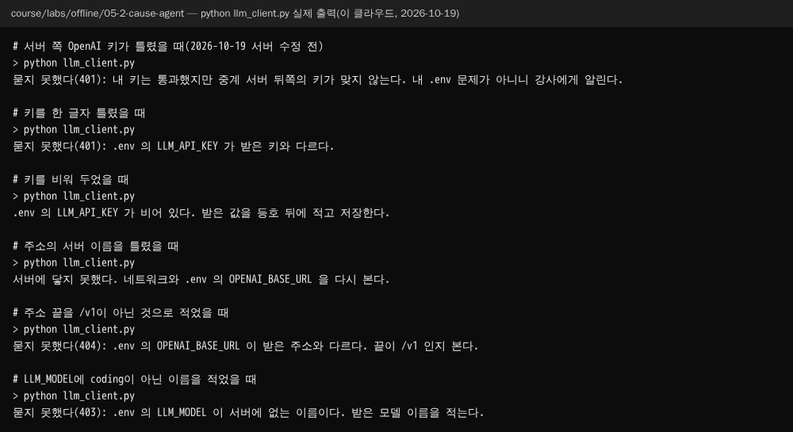

| 나온 글 | 고칠 곳 |
|---|---|
| `LLM_API_KEY 가 비어 있다` | `.env`를 저장했는지(탭 이름 옆 흰 점) 본다 |
| `LLM_API_KEY 가 받은 키와 다르다` | 키를 다시 붙여 넣는다. 앞뒤 따옴표 · 빈칸이 없어야 한다 |
| `LLM_MODEL 이 서버에 없는 이름이다` | `LLM_MODEL=coding`. Copilot 채팅의 모델 이름(GPT-6 Luna)과는 별개다 |
| `OPENAI_BASE_URL 이 받은 주소와 다르다` · `서버에 닿지 못했다` | 주소를 다시 붙여 넣는다. 끝이 `/v1`이다. 학교 네트워크가 막혔는지도 본다 |
| `중계 서버 뒤쪽의 키가 맞지 않는다` · `서버가 지금 요청을 받지 못한다` | 학생 쪽 문제가 아니다. 강사에게 알린다. 429는 1분 뒤 다시 실행하면 대개 풀린다(서버가 막 깨어날 때 한 번 관찰) |

## B. 화면만 열리는지 (시간 나면)

포털 왼쪽 메뉴에서 차례로 누르고, 별도 도구는 주소를 연다. 화면이 뜨면 통과다.

| 화면 | 여는 곳 |
|---|---|
| 실시간 모니터링 | 포털 메뉴 |
| 지식 지도 | 포털 메뉴 |
| 조치 판단 규칙 | 포털 메뉴 |
| 조건별 손익 | 포털 메뉴 |
| 지식 관리 | 포털 메뉴 |
| 흐름 가져오기 | 포털 메뉴 |
| FUXA (설비 운전 화면) | `http://127.0.0.1:1881` |
| Grafana (설비 추세) | `http://127.0.0.1:3000` |
| Neo4j Browser (지식 그래프) | `http://127.0.0.1:7474` — 로그인 화면이 뜨면 통과 |
| Supabase Studio (업무 DB) | `http://127.0.0.1:54323` |

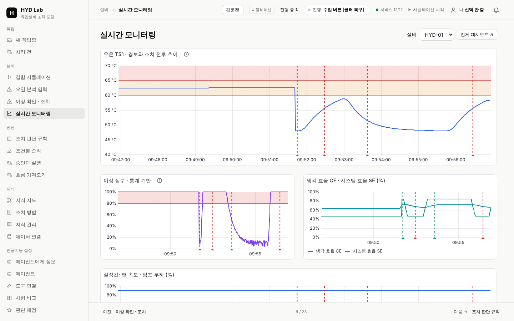

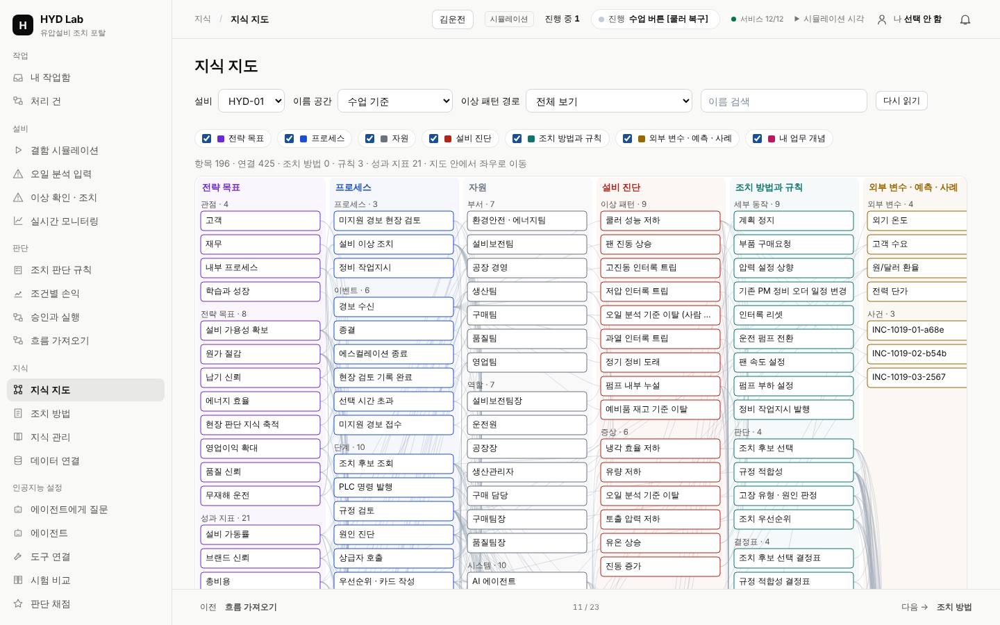

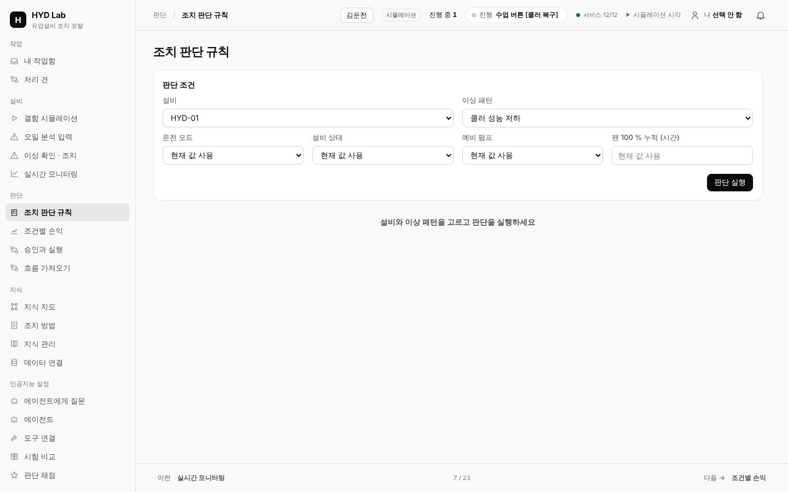

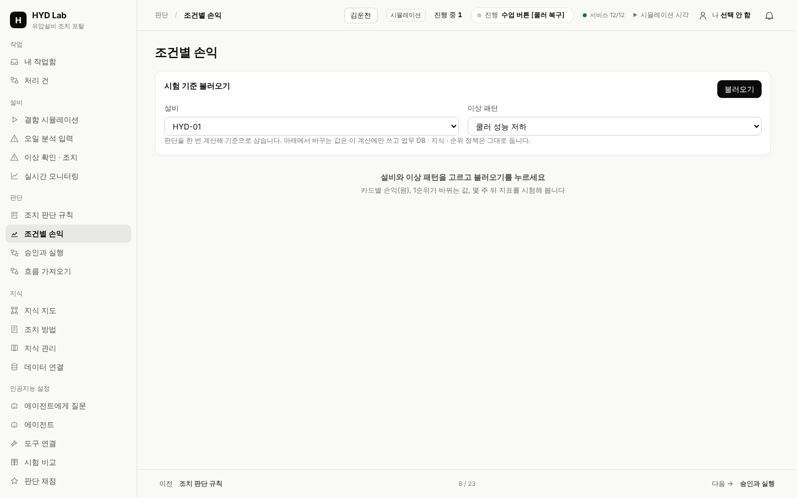

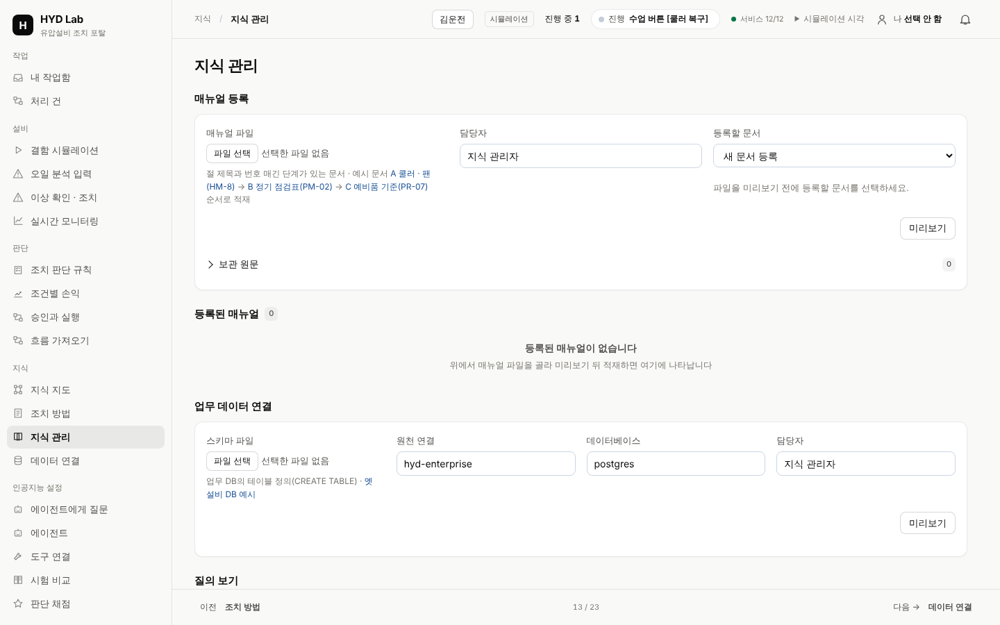

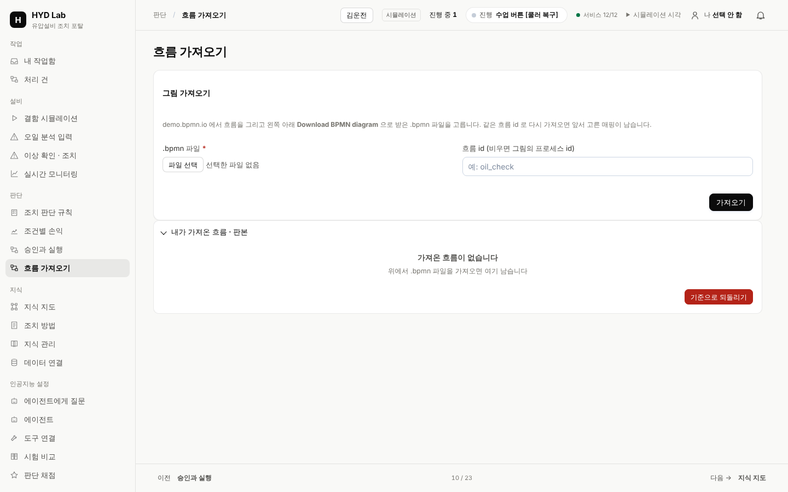

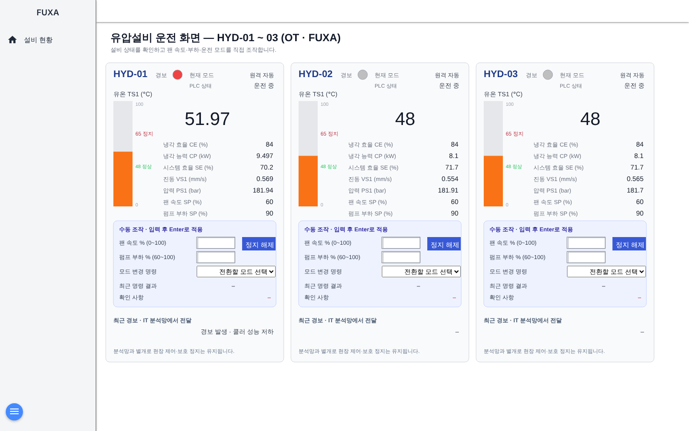

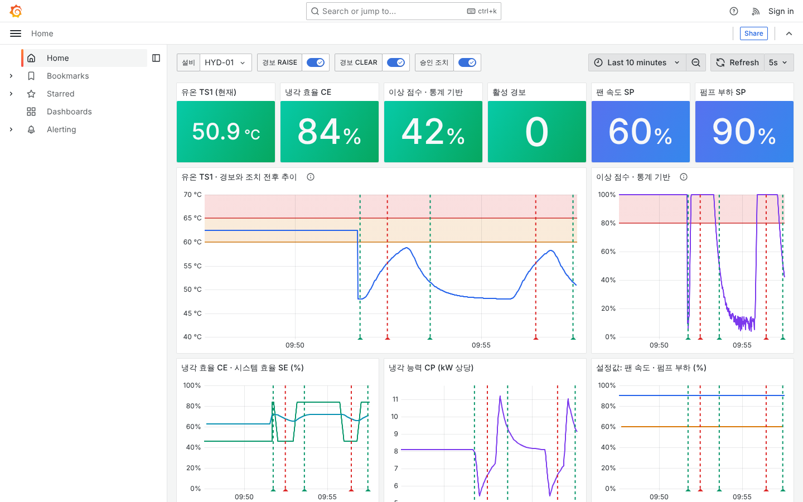

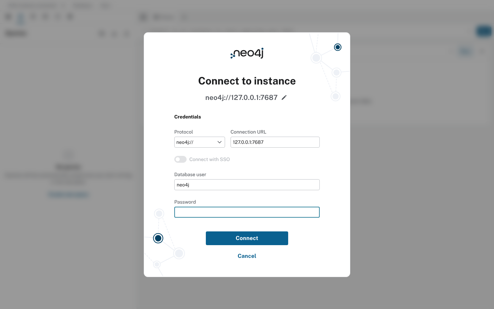

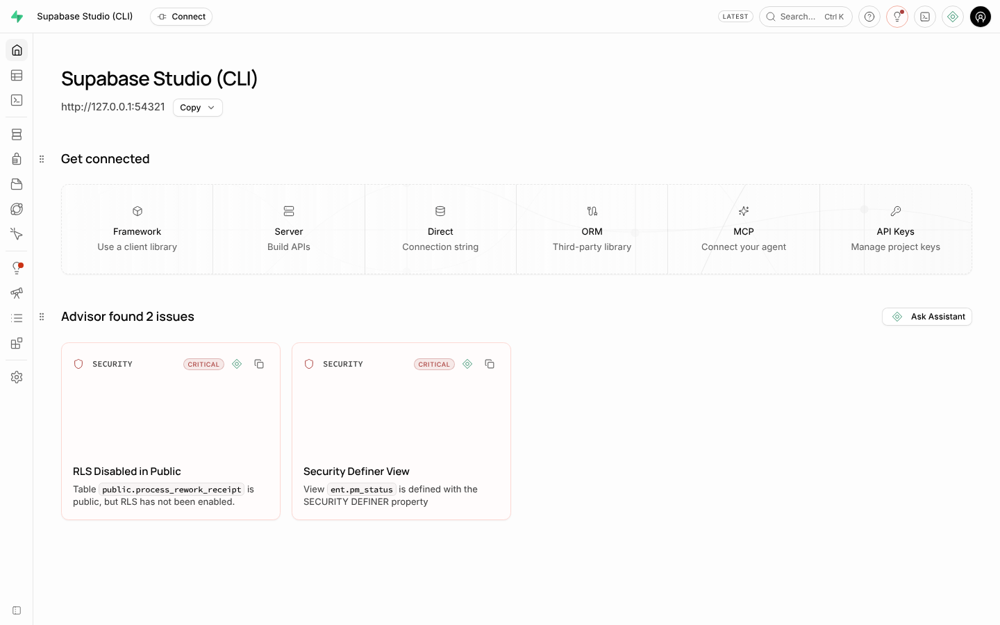

## C. 막혔을 때 첫 조치

`시작.bat` 창에 `[멈춤]`으로 시작하는 줄이 나오면 그 줄의 뜻과 첫 조치는 아래와 같다. 더 자세한 것은 `문서/시스템/참조/RUNBOOK.md` §3이다.

| `[멈춤]` 문구 | 뜻 | 첫 조치 |
|---|---|---|
| `Git for Windows가 없습니다` | `시작.bat`이 bash를 못 찾았다 | Git을 설치하고 다시 더블클릭 |
| `Docker가 응답하지 않습니다` | Docker Desktop이 꺼져 있거나 아직 켜지는 중 | Docker Desktop을 켜고 「Engine running」을 기다린 뒤 다시 |
| `docker compose가 없습니다` | Docker Desktop이 오래된 판 | Docker Desktop 최신판 설치 |
| `Supabase가 켜지지 않았습니다` | 업무 DB 포트(54321~54329) 충돌이나 이미지 받기 실패 | `cd it/supabase && supabase stop` 뒤 다시(RUNBOOK §3 「Supabase 포트 충돌」) |
| `docker compose up이 실패했습니다` | 이미지 받기 · 빌드 실패 | 창의 오류에서 서비스 이름을 찾아 `docker compose logs <서비스>`. 이미지 받기 한도면 D절 |
| `enterprise-mcp · dmn-mcp가 올라오지 않았습니다` | MCP 서버 두 개가 안 떴다 | `docker compose up -d enterprise-mcp dmn-mcp`를 다시 |
| `응답하지 않는 포트: …` | 3분 안에 상태 확인이 끝나지 않았다 | 8080이면 `docker restart hyd-iot-edu-process-1`(RUNBOOK §3 첫 줄). 메모리로 죽으면 Docker Desktop 메모리 4 GB 이상 |

포털에서 경보가 안 나면 HYD-01 카드의 운전 모드가 **원격 자동**인지 본다(RUNBOOK §3 「승인했는데 PLC ACK가 없다」 · 「경보가 안 난다」).

## D. 현장 위험: 같은 학교 IP에서 동시에 이미지를 받으면 막힌다

처음 `시작.bat`은 Docker Hub와 Supabase 레지스트리에서 이미지를 많이 받는다. 같은 공인 IP 뒤의 PC 여러 대가 동시에 받으면 Docker Hub는 `429 Too Many Requests`를 낸다.
이 클라우드에서도 Supabase 이미지(public.ecr.aws)를 받다가 한도에 걸려 재시도하는 줄이 실제로 나왔다(재시도로 통과).

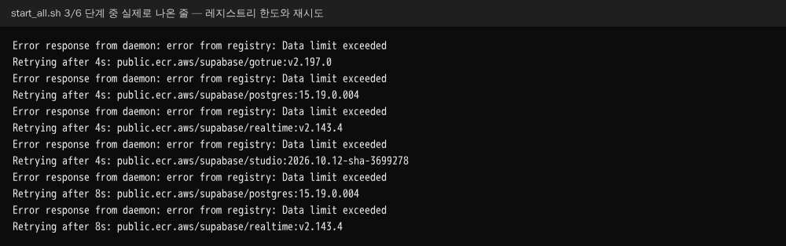

대책은 둘이다.

- ⓐ **한 대씩 받는다.** 첫 PC의 `시작.bat`이 4/6 단계를 넘긴 뒤 다음 PC를 시작한다.
- ⓑ **강사가 미리 이미지 묶음을 만들어 나눠 준다.** 강사 PC에서 `docker save`로 묶음 파일을 만들어 USB · 공유 폴더로 나눠 주고, 학생 PC에서 `docker load`로 넣은 뒤 `시작.bat`을 실행한다. 받기가 없어져 한도와 학교 대역폭 모두 피한다.

## E. 이 문서가 확인하지 못한 것

- Windows에서 `시작.bat` · `끄기.bat`을 더블클릭하는 것, Docker Desktop · WSL2 설치 화면(「자리」 표시).
- 학교 네트워크에서 LiteLLM 서버 · Docker Hub에 닿는지, 여러 대가 동시에 받을 때의 시간.
- ③-2를 학생 PC의 수업 흐름(매뉴얼 적재 뒤)으로 돌린 것. 이 문서의 ③-2는 회귀 시험용 전체판 지식으로 돌렸다.
