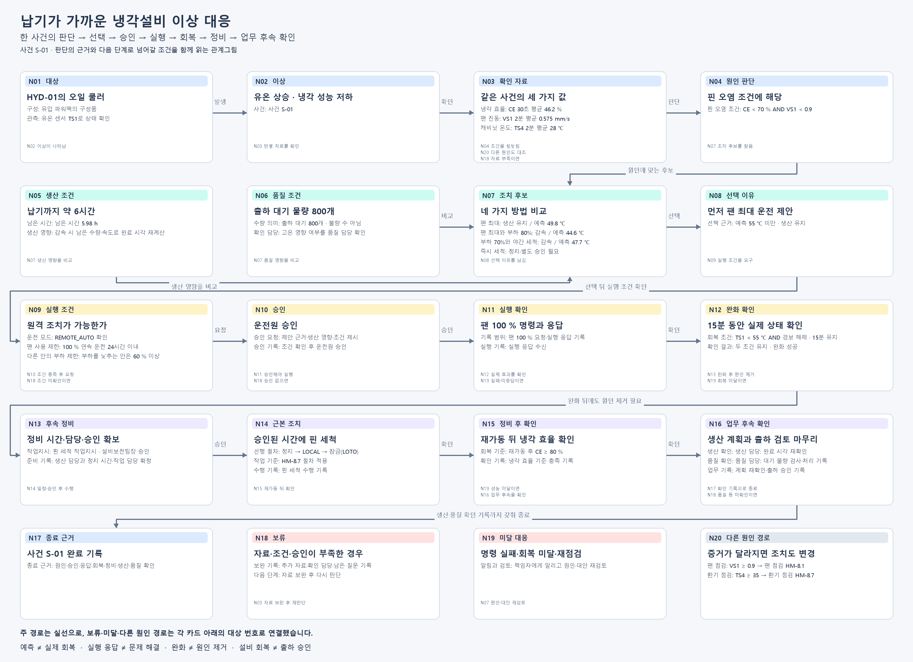

# 납기가 가까운 냉각설비 이상 대응 — 최종 그림 명세

2026-10-22 개정. 기존 단순 원인 비교 그림을 대체하는 현재 제작판이다.

목적은 이상 발견 → 원인 근거 확인 → 생산·품질 영향을 고려한 조치 선택 → 조건·승인 → 실행 응답 → 실제 회복 확인 → 원인 제거 정비 → 생산·품질 후속 확인 → 종료를 하나의 사건으로 읽는 것이다.

## 노드와 입력할 내용

|ID|종류|이름|속성·설명|
|---|---|---|---|
|N01|대상|HYD-01의 오일 쿨러|구성: 유압 파워팩의 구성품 / 관측: 유온 센서 TS1로 상태 확인|
|N02|이상|유온 상승 · 냉각 성능 저하|사건: 사건 S-01|
|N03|확인 자료|같은 사건의 세 가지 값|냉각 효율: CE 30초 평균 46.2 % / 팬 진동: VS1 2분 평균 0.575 mm/s / 캐비닛 온도: TS4 2분 평균 28 ℃|
|N04|원인 판단|핀 오염 조건에 해당|핀 오염 조건: CE < 70 % AND VS1 < 0.9|
|N05|생산 조건|납기까지 약 6시간|남은 시간: 남은 시간 5.98 h / 생산 영향: 감속 시 남은 수량·속도로 완료 시각 재계산|
|N06|품질 조건|출하 대기 물량 800개|수량 의미: 출하 대기 800개 · 불량 수 아님 / 확인 담당: 고온 영향 여부를 품질 담당 확인|
|N07|조치 후보|네 가지 방법 비교|팬 최대: 생산 유지 / 예측 49.8 ℃ / 팬 최대와 부하 80%: 감속 / 예측 44.6 ℃ / 부하 70%와 야간 세척: 감속 / 예측 47.7 ℃ / 즉시 세척: 정지·별도 승인 필요|
|N08|선택 이유|먼저 팬 최대 운전 제안|선택 근거: 예측 55 ℃ 미만 · 생산 유지|
|N09|실행 조건|원격 조치가 가능한가|운전 모드: REMOTE_AUTO 확인 / 팬 사용 제한: 100 % 연속 운전 24시간 이내 / 다른 안의 부하 제한: 부하를 낮추는 안은 60 % 이상|
|N10|승인|운전원 승인|승인 요청: 제안 근거·생산 영향·조건 제시 / 승인 기록: 조건 확인 후 운전원 승인|
|N11|실행 확인|팬 100 % 명령과 응답|기록 범위: 팬 100 % 요청·실행 응답 기록 / 실행 기록: 실행 응답 수신|
|N12|완화 확인|15분 동안 실제 상태 확인|회복 조건: TS1 < 55 ℃ AND 경보 해제 · 15분 유지 / 확인 결과: 두 조건 유지 · 완화 성공|
|N13|후속 정비|정비 시간·담당·승인 확보|작업지시: 핀 세척 작업지시 · 설비보전팀장 승인 / 준비 기록: 생산 담당과 정지 시간·작업 담당 확정|
|N14|근본 조치|승인된 시간에 핀 세척|선행 절차: 정지 → LOCAL → 잠금(LOTO) / 작업 기준: HM-8.7 절차 적용 / 수행 기록: 핀 세척 수행 기록|
|N15|정비 후 확인|재가동 뒤 냉각 효율 확인|회복 기준: 재가동 후 CE ≥ 80 % / 확인 기록: 냉각 효율 기준 충족 기록|
|N16|업무 후속 확인|생산 계획과 출하 검토 마무리|생산 확인: 생산 담당: 완료 시각 재확인 / 품질 확인: 품질 담당: 대기 물량 검사·처리 기록 / 업무 기록: 계획 재확인·출하 승인 기록|
|N17|종료 근거|사건 S-01 완료 기록|종료 근거: 원인·승인·응답·회복·정비·생산·품질 확인|
|N18|보류|자료·조건·승인이 부족한 경우|보완 기록: 추가 자료·확인 담당·남은 질문 기록 / 다음 단계: 자료 보완 후 다시 판단|
|N19|미달 대응|명령 실패·회복 미달·재점검|알림과 검토: 책임자에게 알리고 원인·대안 재검토|
|N20|다른 원인 경로|증거가 달라지면 조치도 변경|팬 점검: VS1 ≥ 0.9 → 팬 점검 HM-8.1 / 환기 점검: TS4 ≥ 35 → 환기 점검 HM-8.7|

## 관계 — 출발·이름·도착을 문장으로 읽기

|출발|관계 이름|도착|
|---|---|---|
|N01|이상이 나타남|N02|
|N02|판별 자료를 확인|N03|
|N03|조건을 뒷받침|N04|
|N03|다른 원인도 대조|N20|
|N03|자료 부족이면|N18|
|N04|조치 후보를 찾음|N07|
|N05|생산 영향을 비교|N07|
|N06|품질 영향을 비교|N07|
|N07|선택 이유를 남김|N08|
|N08|실행 조건을 요구|N09|
|N09|조건 충족 후 요청|N10|
|N09|조건 미확인이면|N18|
|N10|승인해야 실행|N11|
|N10|승인 없으면|N18|
|N11|실제 효과를 확인|N12|
|N11|실패·미응답이면|N19|
|N12|완화 후 원인 제거|N13|
|N12|회복 미달이면|N19|
|N13|일정·승인 후 수행|N14|
|N14|재가동 뒤 확인|N15|
|N15|성능 미달이면|N19|
|N15|업무 후속을 확인|N16|
|N16|확인 기록으로 종료|N17|
|N16|품질 등 미확인이면|N18|
|N18|자료 보완 후 재판단|N03|
|N19|원인·대안 재검토|N07|

실선 주 경로와 카드 아래 대상 번호로 표시한 예외 관계는 같은 사건에 속한다. 조건이 충족됐다는 근거가 없으면 성공 경로를 통과시키지 않는다. 원인→고장이라는 기존 지식 관계와 사건의 확인·승인 순서를 구별한다. 이 제작판은 사건의 판단 근거와 후속 조치를 연결하는 관계모형이며, 화살표를 그렸다고 실행 엔진이 동작하는 것은 아니다.

## 자료와 가정의 구별

이 그림은 **기존 자료를 바탕으로 재구성한 하나의 교육용 사건 S-01**이다. 과거 한 실행 로그를 그대로 재현한 것이 아니며, 이번에 설비·서비스·브라우저를 실행해 관측한 결과도 아니다.

- 입력값 CE 46.2 %, VS1 0.575 mm/s, TS4 28 ℃와 남은 납기 5.98 h·출하 대기800개: `문서/교재/사실표/통합반_01일차_기술사실표.md` 5.3절의 기존 기록을 교육용 입력으로 재사용한다. 납기 잔여시간은 이 입력의 기준 시점 값이며 영상 재생 중 현재 시간으로 갱신되는 값이 아니다.
- 판별·원격 조건·승인·정비·회복 기준: `산출물/실전반/실습/01회차/랩/01일차_실습4_관계그림/참고_HM-8_매뉴얼.md` HM-8.4–8.8. 원격 조치는 HM-8.5, 완화 확인은 HM-8.6, 핀 세척과 재가동 후 확인은 HM-8.7이다. 다른 원인의 팬 점검은 HM-8.1을 따른다.
- 후보별 예측49.8/44.6/47.7 ℃: `문서/교재/사실표/통합반_02-04일차_기술사실표.md`의 ‘쿨러 과열 한 건의 실제 판단 결과’에 실린 기존 승인 카드 고정본에서 가져온 비교 예시다. 서로 다른 출처의 기존 값을 교육용 사건으로 재구성했으며 동일 사건의 새 실측이라고 주장하지 않는다. 즉시 핀 세척은 정지와 근본 조치의 차이를 비교하며 기존 단기 예측62.5 ℃를 세척 후 성능이라고 해석하지 않는다.
- N10–N16의 승인·응답·15분 지속 회복·정비 일정 확보·정비 수행·재가동 기준 충족·생산 계획 재확인·출하 승인은 **이 원고에서 새로 정한 교육용 가정 결과**다. 회복 수치나 납품 완료 실적을 새로 꾸며 넣지 않는다. 가정 결과와 실제 실행 근거를 분리한다.
- 생산/품질 담당의 검토·출하 승인 흐름은 이번 시나리오의 교육 설계다. 기존 시스템에 이 승인 기능이 이미 구현됐다는 주장이 아니다. 품질의 실제 검사 기준·검사 결과는 자료에 없으므로 임의의 허용 불량률·검사 합격값을 만들지 않는다.
- 도식의 한국어 관계명·종류는 초보자가 문장으로 읽을 수 있도록 정한 제작 표현이다. 기존 시스템의 저장 스키마, 새 자동 실행 규칙, 완전한 공장 전체 온톨로지라고 설명하지 않는다. 후속 수업에서 구조를 구체화할 **한 사건의 완결된 판단·조치 관계모형**이다.

## 완성 판정

- 20개 노드·26개 관계가 명세와 맞고 출발·도착·조건을 읽을 수 있다. 수량 자체는 학습 목표가 아니다.
- 자료 부족·다른 원인·승인 없음·실행 실패·회복 미달·정비 후 미달·품질 미확인의 처리 경로가 설명된다.
- 예측과 실제 확인, 명령 응답과 회복, 완화와 원인 제거, 정비 완료와 출하 승인이 구별된다.
- 실제 제작 시 JSON·PNG·판단 기록을 저장하고 새 그림에서 JSON을 열어 노드·관계·속성을 모두 대조한다. 지금 JSON은 중립 제작 명세이며 앱의 가져오기 파일이라고 주장하지 않는다.
- 시나리오의 완료는 교육용 가정 안에서의 완료다. 실제 운영의 완료는 각 단계의 실제 기록이 있을 때만 판정한다.
